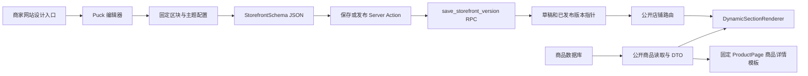
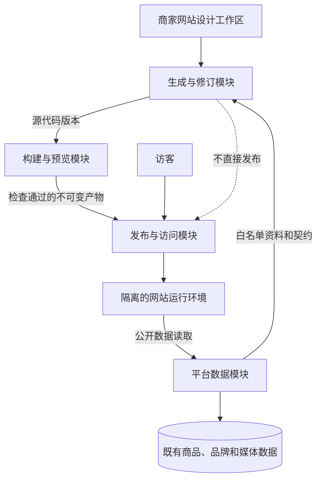

# AI 网站设计：现有架构盘点与目标边界

日期：2026-11-16  
状态：架构设计基线，尚未实施。只完成现状盘点、目标决策和接口边界，不生成网站、不安装开源建站器、不变更数据库或部署。

> 后续变更：用户已要求直接删除旧编辑器，Puck、适配层及专属写入口现已移除。第 2 节保留删除前盘点作为历史证据；当前状态见 [删除记录](review/old-storefront-editor-removal-2026-11-16.md)。

## 1. 结论与范围

目标是保留 Omnilink 管理的商品、品牌、素材、权限和发布能力，让 AI 直接生成前端源代码。页面布局和样式不再受当前十类区块限制。

“固定数据源”指事实由平台维护、结构和访问方式受控，不表示把商品数据冻结在某个生成版本。商品数据变更和网站代码变更是两个独立过程。

本轮面向商家网站。创作者内容工作台、消费者个人记忆、支付与履约不在改造范围。商家工作台自身仍是平台维护的应用，AI 不负责生成或修改后台。

本盘点依据本地源码、配置和迁移文件。没有核实云端已应用迁移、生产域名、证书、容量或计费情况，因此下文“已有”表示仓库存在对应实现，不表示完成生产验收。

## 2. 删除前的架构与证据

### 2.1 编辑、保存、发布和访问

| 环节 | 当前实现 | 位置 |
|---|---|---|
| 设计入口 | 服务器读取店铺、草稿和编辑用商品，客户端加载编辑器 | `app/dashboard/storefront/page.tsx`、`components/storefront/StorefrontHub.tsx` |
| 编辑方式 | Puck 编辑区块字段、排序和主题；只有登记过的区块可用 | `components/storefront/StorefrontEditor.tsx`、`lib/storefront/puck-adapter.ts` |
| 页面表达 | `StorefrontSchema` 的 theme、sections、content、style 等 JSON；十类 SectionType | `lib/storefront/schema.ts` |
| 预览 | 复用当前应用内的区块渲染器，Puck iframe 同步宿主样式 | `StorefrontEditor.tsx` 的 `Render`、`Puck`、`iframe` 配置 |
| 保存和发布 | 校验登录、店铺权限与 schema，调用版本 RPC | `app/actions/store.ts` |
| 发布版本 | 插入 schema 版本并事务更新指针；保留旧系统发布位兼容写入 | `supabase/migrations/20261013050630_versioned_storefront_publish.sql` |
| 首页访问 | `/store/[store_slug]` 读取已发布 schema 和公开商品，渲染固定区块 | `app/store/[store_slug]/page.tsx`、`lib/storefront/service.ts` |
| 商品详情 | 读取商品 DTO 后渲染固定 `ProductPage`；包含商品 JSON-LD | `app/store/[store_slug]/products/[id]/page.tsx` |
| 下线 | 有取消发布 Action 和 RPC | `app/actions/store.ts` |
| 回滚 | 有历史版本和指针基础，未发现完整的面向商家的版本选择、验证和回滚操作链路 | `app/actions/store.ts`、版本迁移 |

**现有 iframe 是编辑布局工具，不是任意生成代码的执行沙箱。** 不能在它里面直接运行 AI 输出，再据此宣称完成隔离。

**现有版本管理保存的是 JSON 页面配置，不是前端源代码或编译产物。** 不能把现有“保存、发布”接口直接当作生成网站发布器。

### 2.2 数据与访问规则

| 数据 | 当前真实来源或规则 | 目标处理 |
|---|---|---|
| 租户和店铺 | organizations / organization_members / stores；请求层成员校验，数据库有 RLS | 保留归属体系，不为生成网站复制商家账号体系 |
| 商品 | catalog_items / catalog_variants / catalog_media / catalog_item_channels | 作为自有商家商品事实来源；禁止生成器另建商品库 |
| 公开商品 | `getStorefrontProducts` 按店铺组织、active 状态及渠道可见性过滤，再归一化 DTO | 沿用过滤原则，建设版本化、可跨运行环境消费的公开接口 |
| 编辑用商品 | `getEditorStorefrontProducts` 允许 active 和 draft | 仅登录编辑预览使用，不能混入公开接口或正式首屏 |
| 商品和店铺 DTO | `lib/storefront/types.ts`、`normalize.ts` | 作为起点；价格状态、币种、变体、媒体和分页需正式定义新契约 |
| 品牌与联系方式 | stores、store_settings、品牌项目及当前 schema.globalInfo 等多处承载 | 先明确字段归属，再统一提供品牌资料；不直接把整份数据库行交给生成器 |
| 上传媒体 | 现有 `lib/product-media/upload-client.ts` 调用商家上传接口 | 沿用上传与归属流程；对外只暴露允许公开的资源 |

需要特别保留以下事实：

1. 公开商品读取默认有限量，当前不是完整分页接口；编辑预览和公开读取的过滤不同，不能合并成一个“全部商品”请求。
2. 现有 DTO 已是白名单起点，但它不等于专供生成网站使用的稳定网络协议。底层服务依赖 Next.js 请求环境，不能直接塞进独立运行的网站包。
3. 消费者发现页当前使用 `fiveStoreDemoProducts`；`lib/products/consumer-catalog.ts` 从五店 JSON 目录读取。商家店铺则读取数据库。这两条线尚未统一，不能宣称商家发布已自动同步到整个市场。
4. 商家演示列表的 `DEMO_PRODUCTS` 当前为空。演示空列表不等于没有数据库商品能力，也不应通过 AI 编造商品弥补。

### 2.3 AI、运行环境与商业闭环

| 能力 | 当前状态 | 证据与限制 |
|---|---|---|
| 模型调用 | 已有文本、图像、流式调用基础 | `lib/ai/workspace-generation.ts`、`workspace-stream.ts` |
| 工作台 AI | 商品与知识库问答、文案和图片相关任务 | `WorkbenchHome.tsx` → `/api/knowledge/assistant`，返回 content / images；不是网站文件修改协议 |
| 商品内容生成 | 有素材和渠道内容生成接口 | `/api/content/generate`；不是构建、托管网站的实现 |
| 网站代码生成任务 | 未发现完整链路 | 无网站文件工作区、差量修改、构建任务、构建诊断闭环 |
| 代码沙箱 | 未发现接入 | 未接入用于运行生成网站的 E2B / WebContainer 等实现 |
| 构建产物托管 | 当前应用自身由 Next.js 构建 | 没有按店铺管理的生成代码产物、运行实例与发布记录 |
| 默认公开地址 | 已有路径地址 | `/store/[store_slug]`；不代表已支持每店子域名 |
| 独立域名 | 预留字段 | 数据库有 custom_domain，未发现域名验证、证书、Host 到店铺的完整路由链路 |
| 购物车和结算 | 有购物车界面；结算入口重定向回购物车 | `app/store/[store_slug]/cart`、`checkout/page.tsx`；当前商品展示开关写 `is_purchasable: false`，不能承诺完整在线交易 |

## 3. 目标架构决策

### 3.1 五个模块及职责

| 模块 | 对外接口职责 | 实现需要隐藏的复杂性 |
|---|---|---|
| 平台数据模块 | 提供店铺资料、商品列表、商品详情和媒体引用 | 租户过滤、价格归一、公开状态、分页、缓存失效、数据库结构 |
| 生成与修订模块 | 接收需求和基准版本，输出文件版本与修改说明 | 模型选择、上下文裁剪、差量应用、冲突检测、生成任务续接 |
| 构建与预览模块 | 将指定源代码版本变成可验证的预览和构建结果 | 依赖锁定、隔离执行、构建日志、资源限额、预览访问凭据 |
| 发布与访问模块 | 发布指定构建、回滚到指定已发布产物、解析访问地址 | 发布授权、原子指针切换、CDN 失效、域名验证与证书 |
| 网站设计工作区 | 展示对话、预览、错误、版本和发布状态 | 不持有模型或管理密钥；不直接执行生成代码 |

模块名称是职责设计，不表示必须拆成五个独立部署服务。生成、构建和网站执行需要与主应用形成隔离的执行环境；数据和发布控制可以继续由主应用负责。

### 3.2 前端自由度

确定采用 **React + TypeScript 源代码产物**。AI 可以自由生成页面结构、CSS、响应式布局、组件和展示交互；不要求输出既有 SectionType，不把 Puck JSON 作为生成结果的唯一表达。

初期生成网站文件范围：页面、组件、样式、静态资源引用、必要的 UI 文案。平台管理启动入口、数据 SDK、可信请求上下文和构建配置；依赖只能来自经核准并锁定版本的集合。依赖集合限制供应链与运行方式，不限制商家的视觉设计。

模板只作为可选的项目脚手架，不能继续成为页面布局上限。生成网站默认采用平台主题和设计约束；只有商家明确提出品牌方向时才调整其对外视觉，后台自身的 UI 规范不由网站生成任务改写。

### 3.3 运行与首屏

选择“独立隔离的网站运行环境”，不在 Omnilink 主 Next.js 服务进程内 eval、动态装载或执行模型生成的服务端模块。

目标产物包含客户端资源、受控的服务端渲染入口和清单。公开店铺及商品页首个 HTML 应包含有效商品内容，兼顾搜索引擎和分享预览；纯客户端请求后才出现商品的方案不作为最终网站运行架构。

生成代码的服务端渲染也必须在隔离环境中执行。可信数据加载器先确定店铺和可公开数据，再把白名单数据交给网站；网站模块不接收数据库连接、管理凭据或商家会话。

本轮确定执行隔离与输入输出要求，不指定 E2B、Vercel Sandbox 或其他供应商；也不因预览采用某家沙箱，就假设它自动解决正式网站托管、SSR、域名或成本问题。这些是下一阶段选型必须回答的问题。

## 4. 固定数据源与生成代码的边界

### 4.1 数据契约

以下为目标契约草案，不是已经存在的接口：

- **SiteContext**：平台解析得到的 siteId、storeId、locale、公开地址和当前发布版本。生成代码不能通过输入另一个 storeId 获取其他商家的内容。
- **StorefrontData v1**：品牌名称、介绍、logo、公开联系资料、媒体引用、商品分页列表、商品详情、可公开的变体与规格。
- **商品价格**：amount / inquiry / free / unknown 必须显式区分；金额与币种配套；未知价格不能转换为“免费”或虚构价格。
- **库存**：只公开业务允许的可售状态或数量；内部成本、供应商、客户和私有资料不进入网站契约。
- **ResourceRef**：资源标识和可用地址；编辑期私有图片不能作为永久公开地址写入正式构建。
- **版本号**：网站产物声明需要的数据契约与运行协议版本，发布器检查兼容性；缺字段或不兼容应明确失败，不能静默编造默认商品。

计划提供公开的店铺资料、商品分页和商品详情读取接口，以及一个与框架内部数据库代码分离的数据 SDK。确切 URL 在实现接口设计时落定，本轮不虚构已经上线的端点。

### 4.2 四类权限

| 发起方 | 可访问 | 不可访问 |
|---|---|---|
| 已登录商家 | 自己可管理店铺的草稿、编辑资料、生成版本 | 其他组织的草稿与私有资产 |
| 生成任务 | 当前任务批准的品牌、素材、商品样本和接口说明 | 整个数据库、消费者记忆、账号或管理密钥 |
| 私有预览 | 有期限且绑定店铺、构建和查看者权限的编辑预览数据 | 仅靠一个公开 URL 就读取草稿、使用任意店铺 ID 切换数据 |
| 正式网站 | 当前店铺已公开数据、公开媒体、受控平台操作 | 商家登录态、后台写入接口、数据库管理权限 |

后台与预览使用不同源；iframe 只是展示容器。跨源消息校验 origin、source、会话标识和消息类型，不能向后台传递任意脚本执行请求。现有全局宽泛 CORS 配置不能当作草稿预览权限机制。

预览及公开页面采用平台生成的内容安全策略，限制网络请求和资源来源；不能只隔离服务端进程，却允许生成的浏览器脚本不受限制地访问后台。发布响应的 CSP、Cookie 与可信头配置不能由生成代码覆盖。

代码隔离需要覆盖进程、文件、网络、执行时长和资源用量。生成、构建、预览、正式渲染各有自己的权限，不能把“构建成功”视作“代码可信”。

### 4.3 动态数据和业务操作

- 商品名称、价格、可售状态、详情中的商品事实来自数据模块，不写成生成文件中的永久数组。
- 布局、品牌叙事、样式和展示交互可以保存在网站代码中。涉及商品事实的营销文字必须绑定事实或作为待商家确认的独立内容，不自动随意推断折扣、材质、评价或销量。
- 生成时可以用最小样本帮助 AI 理解排版；样本带预览标记，不能通过发布验证进入真实店铺冒充在售数据。
- 商品更新不触发整个网站重新生成；通过店铺范围缓存失效，在下次读取时更新。初期公开商品数据采用不跨请求共享缓存的策略；后续启用缓存时必须同时定义失效事件和可见延迟，不能承诺所有已打开浏览器立刻同步。
- 取消发布、商品下架和权限撤销立即阻止新的公开读取，不能仅依赖静态 HTML 副本。已有浏览器或外部搜索缓存不属于即时撤回保证。
- 当前售卖模式以真实外部商品链接、联系商家为基础。购物车、支付、订单和履约仍由平台业务模块负责；AI 可呈现已接通的操作，但不可生成一个假结算流程。
- 任意前端代码可能显示不真实的信息，类型检查和示例预览不能证明所有运行路径永远不写死价格。发布前需要事实绑定检查、已知数据测试及商家确认；成交金额最终只能由可信平台计算。
- 未来接购物车时由平台校验商品、价格、变体与店铺，前端传回的金额不能作为成交依据。本轮不接支付。

## 5. 版本、任务与发布边界

明确区分四个对象，禁止混在一个 JSON schema 版本里：

1. **源代码版本**：不可变文件集合及内容摘要、父版本、生成指令引用。发布后继续编辑产生新版本。
2. **构建记录**：源代码版本、依赖锁摘要、数据契约版本、构建器版本、检查结果和日志。修复必须产生新构建。
3. **构建产物**：可执行前端资源、隔离渲染入口和路由清单，不包含数据库或模型密钥。
4. **发布记录**：某店铺在某时刻激活哪个已通过验证的产物，由谁发布；回滚也是一次指针变更并留下记录。

流程：创建任务 → 生成文件版本 → 排队构建 → 类型与依赖检查 → 数据绑定及预览验证 → 可发布 → 商家确认发布。取消、失败和超时都不会覆盖线上版本。耗时任务需要持久化状态，浏览器断开不意味着任务已被取消或完成。

同一任务的重试用幂等标识；编辑和发布都携带基准版本，旧构建不能覆盖新草稿。新版本未就绪前，访客继续看到上一个成功发布版本。

发布沿用“owner/admin 才可发布、editor 可编辑”的现有规则。新产物发布需要新的验证及存储实现，不能绕过现有授权规则；当前 schema RPC 的历史兼容写入也不能直接承载任意 JS。

回滚恢复网站代码和资源版本，**不回滚商品数据库**。旧代码与当前数据契约不兼容时拒绝回滚并说明原因。

本轮只确定概念记录及状态，不写建表 SQL、不提前修改现有 storefront_versions。下一阶段再决定扩展现有发布入口还是新增与之关联的版本记录，需确保 schema 模式与生成代码模式可同时识别。

## 6. 访问、域名与多租户

- 初期保留 `/store/[store_slug]` 的逻辑访问入口，由可信路由解析店铺和发布模式。旧 schema 网站沿用当前渲染；生成网站从此入口跳转到与后台不同源的公开站点地址，不能通过同源反向代理把不可信网站脚本重新放回后台域名。网站源代码的内部路由不要把数据库 storeId 当作租户授权凭据。
- 生成网站运行在与后台分离的源，静态资源路径须支持发布版本隔离；不能让主站登录 cookie 因预览或网站脚本而暴露。
- 自定义域名采用“添加 → 验证所有权 → 配置解析 → 证书就绪 → 激活映射”的独立状态流程；未验证的域名不可占用他人店铺或直接激活。
- Host 到 site/store/release 的映射由平台维护，拒绝未知域名；不能仅从用户传入的 storeId、Host 或任意转发头推断授权。
- 既有 custom_domain 字段只是数据基础，不能视为上述流程已实现。生成网站必须有与后台隔离的默认访问源，优先每店独立源；具体域名命名、供应商及是否提供额外品牌子域名留给部署选型。不使用后台的域级共享 cookie 为生成网站授权。

## 7. 沿用、新增和暂缓

| 处理 | 内容 |
|---|---|
| 沿用 | 店铺及组织归属、商品管理、媒体上传、公开/草稿过滤、DTO 归一化基础、现有公开店铺地址、模型调用基础、发布权限原则 |
| 新增 | 稳定网站数据契约与 SDK、网站生成任务、源代码版本、隔离构建与预览、产物验证、正式隔离渲染、产物发布与回滚、域名映射流程 |
| 保留兼容 | StorefrontSchema 和 DynamicSectionRenderer；仅保留已有公开页面渲染所需部分。Puck 及旧编辑器专属应用层读写动作已按后续指令删除 |
| 改造前先补齐 | 品牌资料归属、编辑/公开商品投影、分页、价格状态及缓存规则；消费者市场与商家目录分离的现状要显式处理 |
| 后续独立处理 | 消费者市场接入真实商家目录、原生支付履约、任意 npm 包、自定义后端、多人实时可视化编辑 |

当前既有公开站点不能因为新生成项目失败而下线。过渡期的站点发布模式应明确区分 schema-v1 和 generated-v1，并通过统一入口读取；这是两种渲染实现的迁移方式，不是复制两套商品数据。

## 8. 下一阶段选型的验收门槛

本轮不决定直接移植 Open Lovable、Onlook、Fragments 或 bolt.diy。后续对照它们实际代码回答：

1. 能否自由修改 React 源码，同时锁住数据 SDK、发布权限和构建基础配置？
2. 能否按租户隔离源代码、任务、预览和日志，并与后台跨源运行？
3. 预览沙箱与正式 SSR 托管分别由谁负责，不能只展示一个开发预览 URL？
4. 能否接入 Omnilink 的现有数据，而不要求复制数据库或重新实现商品后台？
5. 能否管理不可变产物、基准版本冲突、失败重试与明确发布，而非每条对话直接改线上？
6. 依赖许可、沙箱和托管计费、DeepSeek 接入及现有 Next.js / React 版本兼容性是什么？

上述问题完成后，才选择具体实现和启动最小原型。当前不进入生成店铺页面的阶段。

## 9. 开发前必须固化的接口清单

本轮已确定职责和关键不变量。以下为下一轮详细设计的输出，不是要求现在开始实现：

- StorefrontData v1 字段与分页、错误和缓存契约；事实字段与可编辑文案的划分。
- 源文件、入口组件、路由和发布清单的精确协议，以及 SDK 升级兼容方式。
- 任务、源代码版本、构建、产物、发布记录的存储及状态转换。
- 预览身份与域名映射的鉴权协议；正式 SSR 的隔离与网络策略。
- 选定运行方案的容量和成本上限，单次生成/构建的超时和重试限制。

这些接口未定稿前，不把演示生成效果当作目标架构已经完成。
