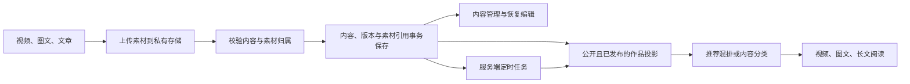

# 内容发布与发现页连通

本轮沿用既有发布界面和白色玻璃主题，ENERGY 1 / RHYTHM 1 / MOTION 1。发布内容是主任务，发现页增加推荐与内容分类，让未绑定商品的作品也可被浏览。编辑器继续采用简约部件排版，不加入 AI 排版。

## 数据与状态

- 视频、图文、文章使用同一 `PublicationDocument`，保留各自素材、封面、正文、背景及发布设置。
- 正式发布使用 `/api/creator-publications`，编辑恢复通过作者专用 RPC，内容管理保留旧记录的编辑兼容入口。
- 素材仍在私有桶中，通过服务端签名读取。发布和素材引用在同一个数据库事务内更新。
- 已发布作品保存草稿时，正式版本保持不变，修改稿与新素材只供编辑者读取；再次确认发布才替换正式版本。
- 状态包括草稿、定时、已发布、回收站。回收会撤下公开记录和素材授权，恢复会还原原状态。
- 可见范围接通公开与仅自己可见。项目没有好友关系模型，暂不提供好友可见选项，旧本机好友可见草稿按私密恢复。
- 定时任务每分钟执行一次，以服务端时间发布到期内容；数据库状态及素材引用同时切换为公开可读。
- 保存权限保存在服务端，视频按该设置显示或隐藏原生下载入口；这属于界面控制，不构成 DRM。

## 读取与阅读

- 发现页读取公开作品，按 ID 的链接可读取不在最近列表中的作品。
- 推荐混排商品与作品，内容分类独立展示作品；混排保证作品只出现一次，没有商品时仍可展示内容。
- 公开投影只向前端提供公开作品字段及对应发布者名称，不返回组织内部资料或修改稿。
- 视频使用稳定素材地址并支持实际播放；图文保留图片及正文；文章复用编辑器同款阅读渲染，保留背景、封面位置与商品链接卡片。
- 预览模式继续保存在本机，并通过 `/discover?creatorPreview=1&post=...` 展示同一份预览作品；来源始终标明为本机预览。
- 正式管理页可以恢复旧本机记录，保存或发布到服务器后将旧本机记录移入回收站。

## 已应用到开发库的迁移

- `20261118014921_creator_publication_delivery.sql`
- `20261118014942_creator_publication_schedule.sql`
- `20261118020341_creator_public_media_policy.sql`

最后一项将公开素材读取与成员预览策略分开，不给匿名用户增加组织成员函数权限。

## 验证记录

- TypeScript 检查和隔离输出目录的生产构建均已通过；修改范围的 ESLint 为 0 错误、17 条既有警告，涉及消费者组件的 effect、依赖及原生图片写法。
- 新增文档校验、事务发布、跨空间访问、修改稿素材隔离、定时与回收恢复的回归测试。
- 真实开发库脚本 `scripts/verify-creator-publication.mjs` 已通过：图文发布与恢复、管理列表、匿名素材读取、修改稿隔离、确认更新、私密内容隔离、视频上传播放地址、文章与商品卡片、真实分钟任务、回收及恢复。
- 浏览器已登录隔离测试账号，实际从管理页进入发现页与详情；内容分类显示四条公开测试作品，没有显示私密测试作品，也没有夹带商品卡片。
- 浏览器实际视频解码 `readyState=4`、`error=null`，键盘启动后处于播放状态。
- 文章背景为 `rgb(244,250,255)`，封面位置为 `50% 68%`，正文及商品卡片均可读取。阅读态选中框已移除，键盘 Tab 在详情控件内循环，Escape 可关闭。
- 发现并修复旧管理接口的素材关联歧义，以及匿名素材策略误用成员权限函数的问题；后者已通过先复现失败、再修正并回归验证。
- 浏览器从正式发布页选择 WebP 文件，上传后显现完整表单，确认发布后管理列表从 5 条增为 6 条，来源显示“线上”；进入发现页后图片和正文均可读取。
- 浏览器将既有图文改为“图文界面连通测试”，先存草稿，再确认发布；管理列表和发现页均显示新标题，没有新增重复记录。
- 最终针对文档、发布接口、素材接口、数据库隔离和内容混排的 10 个测试文件、52 项测试全部通过。
- 隔离构建命令为 `OMNILINK_ISOLATED_PREVIEW=1 npm run build`。既有构建提示包括 middleware 约定迁移和 `local-bge.ts` 的动态文件追踪；本轮没有修改这些模块。
- 管理页的窄屏行列重排、操作换行，以及阅读页的流式宽度已经完成源码复核。最后的 390px 浏览器检查因浏览器连接中断未完成，不计入实测通过项。
- 阅读标题字号通过 BlockNote 的 `--level` 和 `--prev-level` 变量统一到 24px；最后这一处字号修正已通过构建，尚未补拍浏览器截图。
- 清理脚本已撤销隔离账号的会话，并清理其空间、全部素材和账号。数据库复核测试作品剩余 0 条、测试账号剩余 0 个；用户原有内容未参与清理。

## 审查记录

- 安全审查没有报告本轮新增的发布对象问题。项目现存的 `discovery_products` 视图、创空间 RPC 和密码保护提示仍保留，分别参见 [视图权限](https://supabase.com/docs/guides/database/database-linter?lint=0010_security_definer_view)、[函数权限](https://supabase.com/docs/guides/database/database-linter?lint=0029_authenticated_security_definer_function_executable) 和 [密码保护](https://supabase.com/docs/guides/auth/password-security#password-strength-and-leaked-password-protection)。
- 项目原有五张服务端表仍为 RLS 开启且无客户端策略，见 [RLS 检查说明](https://supabase.com/docs/guides/database/database-linter?lint=0008_rls_enabled_no_policy)。本轮没有扩大这些表的客户端权限。
- 素材表对已登录用户存在公开读取与成员预览两条策略，性能审查会提示 [多条允许策略](https://supabase.com/docs/guides/database/database-linter?lint=0006_multiple_permissive_policies)。这里保留角色分离，避免匿名读取再次触发成员函数权限错误。原有内容表外键索引提示见 [索引说明](https://supabase.com/docs/guides/database/database-linter?lint=0001_unindexed_foreign_keys)，本轮不将其表述为已完成的性能优化。

## 交付检查

以下结果限定本轮连通改动；窄屏实测及最后的字号截图仍按上文记录。

- PASS R-02：本轮新增界面文案不使用长破折号和中点分隔。
- PASS R-17、R-18、R-36、R-38：验证账号、作品均明确标为测试，不加入虚构指标、评价或安全承诺。
- PASS R-23：沿用现有导航、图片和图标，没有生成新品牌素材。
- PASS R-24、R-26：发布、编辑、查看和分类入口对应真实页面或处理函数；界面创建、更新与查看流程已有浏览器记录。
- PASS R-25：新增控件沿用既有语义文字与背景色，不新增低对比色层。
- PASS R-27：发布和内容读取均有等待、失败反馈；管理页保留空状态及重试入口。
- PASS R-28：本轮没有新增 FAQ。
- PASS R-32：阅读详情支持 Tab 循环、Shift+Tab 返回和 Escape 关闭，已在浏览器验证。
- PASS R-33：功能直接写入项目源码和迁移，未通过外部脚本注入界面。
- PASS R-34：沿用既有白色主题，本轮没有新增主题切换。
- PASS R-35：开发服务器真实运行，完成界面发布与更新；生产构建及 52 项回归测试通过。
- PASS R-37：延续用户指定的白色液态玻璃、椭圆控件与简约文章方向，ENERGY 1 / RHYTHM 1 / MOTION 1。
- PASS Purpose-Gate：玻璃与椭圆控件继承用户明确要求；文章用正文、封面、商品卡片组织层次，未新增渐变、光晕、装饰图案或模板动画。
- PASS Liveliness：发布页以素材和正文为重心，管理页以作品记录为重心；蓝色只表达必要的当前状态，沿用品牌与内容素材建立辨识。
- PASS C-1、C-2、C-3、C-5：界面改动直接对应发布、管理和阅读任务，数据来自真实测试及数据库记录。
- PASS Quality Locks：沿用现有按钮、间距和语义色；阅读态去除部件选中框，标题层级统一，不将正文卡片改为胶囊。

R-03 与 C-4 的响应式源码复核通过，390px 实测待浏览器连接恢复后补验。此记录不代表已完成全设备验收或生产部署。
