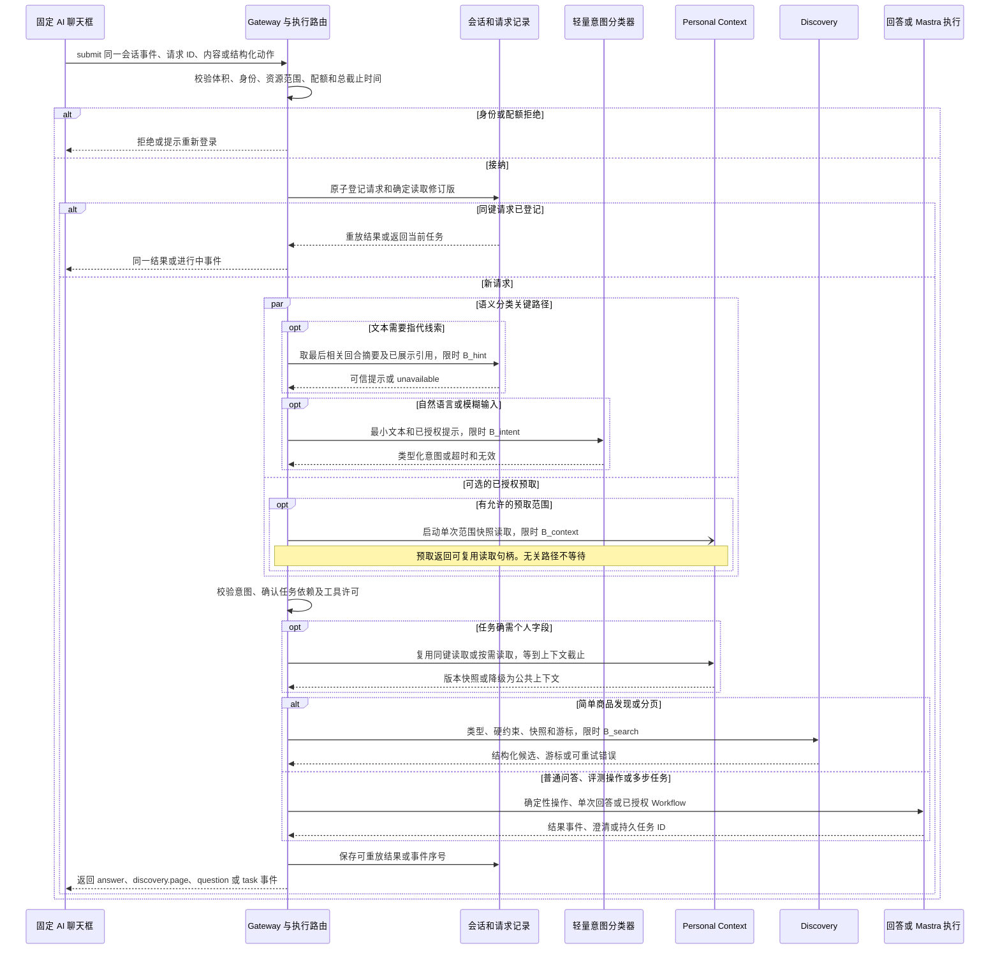

# 02 AI Gateway 审核

## 当前调用与目标

【代码】`POST /api/consumer/assistant` 先检查体积和进程内速率，解析请求，调用 `getUser`，加载用户记忆，写入用户消息，查询最近消息，再以布尔标记、前一意图及正则判定单一意图。随后读取候选、组装上下文，可能直接返回成分索引或少量规则推荐，否则调用模型。商品召回的近期目录查询在 `enabled=false` 时仍发出。模型回答由单次 JSON 响应返回。[入口顺序](../../../app/api/consumer/assistant/route.ts#L135)　[分流](../../../lib/consumer-advisor/consumer-entry-workflow.ts#L46)　[召回并发](../../../lib/consumer-advisor/consumer-entry-workflow.ts#L112)　[模型与返回](../../../app/api/consumer/assistant/route.ts#L411)

【要求】自然语言及模糊表达默认经轻量语义分类，确定的界面操作可直接产生结构化动作。服务器校验实体、范围、任务依赖、费用、权限和是否需要确认，再选择执行路线。输入“沙发”走轻量分类后直接返回发现页。该路径无需额外的回答生成模型或 Mastra Agent。

【假设】分类器输出短结构化结果 `{ intents, mentions, constraints, negations, referenceHints, contextScopes, confidence }`，其中 `intents` 有数量上限并携带依赖。统一约束包含金额和币种、排除项、时效、实体类型、当前回合或长期范围。缺失字段为未知。服务器解析 `referenceHints` 指向的会话或实体，复核拥有者、发布版本和可见性。模型输出的工具名、身份、权限和 UI 文本无法直接触发执行。

## 推荐并发时序 【假设】

- 【假设】登录后才能发起私有预取。Classifier 只需本轮文字和指代线索，比如上轮结果实体 ID、选中引用及短摘要。独立名词或结构化分页可跳过会话提示读。未拿到关键指代线索时，发一个澄清问题。对于“按我上次说的，不要皮的”，先核验上轮对象，再读取必要域的上下文。
- 【假设】请求内以 `subject + scope + contextRevision` 合并同键读取。执行计划需要的范围已经预取时复用同一个 Promise。缺的范围再读。普通问题、公开发现或拒绝时丢弃或取消未消费结果。首期仅按需读取是等价对照组。只有预取命中收益大于额外读取和隐私成本时才启用。
- 【假设】Classifier 失败时，明确 UI 操作仍按校验后的动作执行。词表中明确的单品类查询可走受限公开检索并标注来源。含歧义、否定未解析或多重约束时保留原约束并问一个问题。权限判断缺数据时拒绝私有读写。已鉴权的用户上下文读取超时可退到公共排序，查询源失败与零匹配分别呈现。
- 【假设】多意图采用有向无环的小任务计划。比如“找三款 3000 元以内的沙发并比较材质”先共享检索，再比较真实字段。无依赖的读任务在并发限额内运行。修改偏好生成提案或进入显式确认，后续推荐使用该轮会话条件或确认后的版本。低置信度仅澄清会实质改变结果的字段。

### 关键路径和预算

【假设】给 Gateway 一个总截止时间，向子调用分配 `B_hint`、`B_intent`、`B_context`、`B_search` 及模型执行预算。无预取等待时，首屏主要等待接纳、必需提示、分类、检索和首个有效结果。需要已启动的快照时，分流前成本由分类分支与该快照的较晚完成者决定。分类后才开始的新增范围读取计入串行等待。不要用固定时间或命中率作为承诺。短路径以首批商品事件为首个可用结果，回答路径另量首个可读增量和完成时间。

【假设】限制输入文本、历史摘要、每次可返回的字段和条数。只给模型必要的候选字段与来源 ID，普通问答默认少量会话线索，分类器看不到完整购物评测或大附件。对“图片找相似商品”先使用可见元信息或低成本辨识，再按任务授权加载图片。记录每路的总输入、输出、缓存 token 和模型调用次数，按 P50/P95 和费用比较命中、冷启动、降级、重复请求。模型前缀缓存属于可测优化。把稳定公共规则放前缀，私有上下文按最小范围在后面拼装。[模型缓存审查](07-security-performance-review.md)

【假设】可选且可能不被消费的预取采用请求级并发句柄。Mastra 官方文档的 `.parallel()` 需要等待各分支结束，适合结果都必需的步骤。[Mastra 控制流](https://mastra.ai/docs/workflows/control-flow)

## 【问题】发现

### GW-01 P1 单意图规则缺少语义与实体合同

- **问题与依据** 入口只输出一个枚举意图，`hasActiveSkill`、关键词和前一意图可以决定结果。预算、否定、多个任务和指代未形成统一的类型化计划。[输入与规则](../../../lib/consumer-advisor/consumer-entry-workflow.ts#L19)　[客户端请求](../../../components/consumer-market/context/OmnilinkContext.tsx#L592)
- **实际影响** “不要皮的，比较刚才两款再找一个便宜的”可能仅进入比较，遗漏材料排除和新检索。未经确认的文本会被当作强过滤或丢弃。
- **推荐修正** 轻量分类器产出受 schema 限制的任务和约束，路由用服务端策略裁决。按显式动作绕过模型，按已授权引用解指代。用冻结的代表查询、否定、多意图和越权样例评估。
- **替代与取舍** 扩大规则库可用于模型故障降级，长期会累积语义边界。全交给 Agent 灵活但会增加费用、迟延和越权风险。
- **阻塞范围** 阻塞默认的 V2 自然语言分流。

### GW-02 P1 先取档和目录抬高延迟与 Token

- **问题与依据** 记忆、消息写入和历史读取在规则分流前，普通问答仍可读取近期目录并附上完整档案摘要及候选列表。Middleware 与路由各有一次用户查询路径。[请求前段](../../../app/api/consumer/assistant/route.ts#L153)　[上下文拼装](../../../app/api/consumer/assistant/route.ts#L380)　[中间件](../../../middleware.ts#L84)
- **实际影响** 无关依赖失败会拖慢本可直接完成的任务。模型收到多余私人信息和目录文本，成本随候选数量上涨。
- **推荐修正** 认证与配额先行，小会话提示只在需要时读取。用单请求合并预取和解析。给每路限制并定义鉴权失败、分类失败与资料失败的差异。把历史写入、排序和模型调用计时分开。
- **替代与取舍** 全部预取减少少数慢请求但扩大隐私暴露和 DB 压力。全惰性读取最简单，可能增加明显个性化任务等待，适合作为基线对照。
- **阻塞范围** 阻塞可衡量的 V2 首屏与成本承诺。试点可以先采用按需读取。
