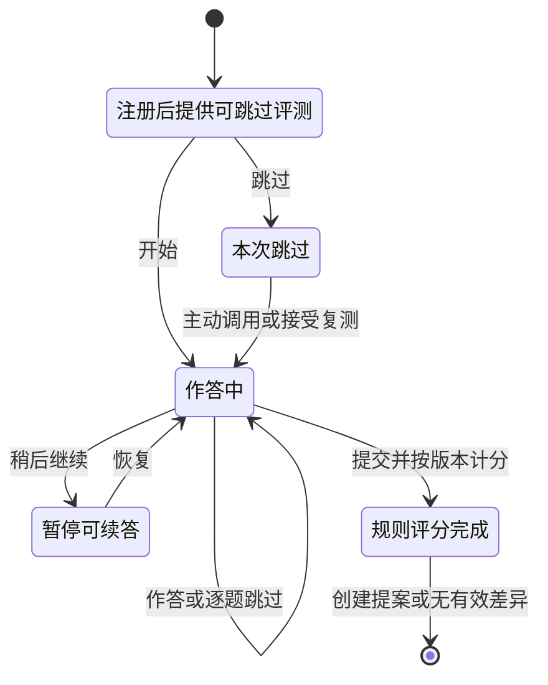
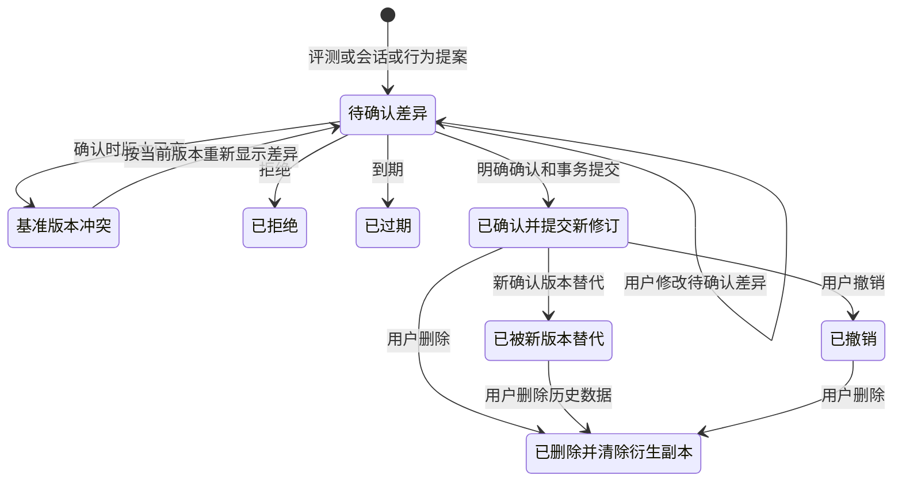

# 03 Personal Context Engine 审核

【要求】Personal Context Engine 管理个人信息和上下文。购物偏好为固定内置评测，注册后提供，可跳过、主动重开或建议复测。评测结果先形成提案，只有确认后才进入正式长期记忆。用户可修改、拒绝、撤销和删除。

【代码】注册写入 onboarding 标记与两个默认技能。首次设置当前完成姓名、头像和 DeepSeek 连接流程，偏好问卷另由发现页参数打开。问卷可逐题跳过、暂停与续答。账号路径通过档案 PATCH 更新 Auth 元数据，演示走本地存储。评分由 TypeScript 规则完成，读取档案时也会根据问卷重建结果。主助手会将问卷和计算结果加入模型上下文。[注册标记](../../../app/actions/auth.ts#L98)　[首次设置](../../../components/consumer-market/screens/InitialAssistantSetup.tsx#L57)　[问卷保存](../../../components/consumer-market/screens/ShoppingPreferenceSurveyFlow.tsx#L48)　[分数重建](../../../lib/consumer-advisor/ai-assistant-profile.ts#L95)　[上下文注入](../../../app/api/consumer/assistant/route.ts#L380)

【代码】消息与记忆表有用户归属 RLS。记忆区分 `origin=user/inferred` 和 `status=active/rejected`，`support_ids` 为 UUID 数组。聊天可验证证据后将旧记忆置为 rejected，并插入新的 active 记忆。手动编辑、确认、拒绝、删除，以及将旧 Auth 元数据迁入表，是不同写入路径。标记为待确认的推断仍可能被纳入当前模型上下文。[RLS 与状态](../../../supabase/migrations/20261024082331_eva_conversation_memory.sql#L19)　[支持项](../../../supabase/migrations/20261024082638_eva_memory_supports.sql#L1)　[聊天写入](../../../app/api/consumer/assistant/route.ts#L456)　[手动写入](../../../app/api/consumer/ai-assistant-profile/route.ts#L44)　[旧数据搬运与读取](../../../lib/consumer-advisor/ai-assistant-memory.ts#L20)

## 【假设】数据所有权和读写规则

| 信息 | 写入来源与权威 | 使用与生命周期 |
| --- | --- | --- |
| 已确认事实 | 用户明确提交的资料与证据，按字段和修订版保存 | 只在任务所需域读取。修改产生新版本。删除后相关索引和缓存退出使用 |
| 已确认长期偏好 | 用户确认提案，或明确提交结构化资料修改 | 影响长期排序的软信号。会话显式要求和硬过滤优先。记来源、确认者、确认时的版本 |
| 当前会话需求 | 会话的结构化动作和本轮明确条件 | 使用范围是当前会话或搜索运行。新意图可清理或替换。跳过保留未知 |
| 低置信度推断 | 由规则或模型生成，记录来源、时间、置信度和期限 | 进入提案或授权的会话建议。正式快照只取有效确认版本。撤销支持证据时失效 |
| 历史会话 | 会话模块保存按序号排列的消息和结果引用 | 消解指代时读取短摘要与有效引用。保留期与长期偏好分别决定 |
| 评测尝试 | 内置题库与规则评分，按题库和评分版本持久化答案、跳过、进度 | 允许续答。评测结果带基准修订版生成待确认差异。默认不进入排序用的长期快照 |
| 证据 | 消息、评测尝试、用户表单或经授权的行为聚合 ID | 证据与主体同一权限域。区分用户原话和推断。删除关联来源时重新判断依赖 |

**读接口。** `readSnapshot(subject, scope, revision)` 仅返回必要事实、确认偏好、当前会话条件和来源 ID。快照为单次运行内只读。模型看到的历史和证据均按数据处理。

**写接口。** `submitAnswer`、`proposeChange`、`decideProposal`、`editConfirmed`、`revoke` 和 `delete` 都进入同一个记忆所有者。行为统计可以提出问卷或提案。只读工具无法提升一项记忆的状态。用户在明确展示差异的修改表单中提交，可作为该修改的确认，仍经过同一写接口。

## 【假设】评测和记忆状态机

- 注册成功后用账号与评测版本去重邀约事件。完成基础资料后在同一聊天会话提供“开始 / 跳过”，跳过即开放浏览。再次评测保留原尝试。发现中的问题由 Discovery 根据可用结果建议，可跳过并继续取页。该答案默认进入当前会话条件，写长期偏好需另给提案。
- `MemoryProposal` 绑定用户、目标字段、旧版本、差异、来源、题库版本、期限与提案版本。事务内校验主体与预期版本，锁定或 CAS 更新，写入新修订、旧版本失效标记、确认记录及 `contextRevision`。重复确认返回相同结果。两标签页发生冲突时返回重新确认所需的差异。旧版本保存为历史，避免原位覆盖。
- 撤销以新修订恢复可用的上一版本，先核对当前修订未被其他确认改动。删除则停止检索并按保留策略清理原始记录、快照、派生向量、缓存和对象引用。保留期及必要审计字段见 [待决事项](08-open-decisions.md)。
- 请求内读合并随请求结束清理。若引入跨请求缓存，键包含可信用户 ID、范围和修订版。事务提交后发布失效事件。检索和任务结果返回前检查当前权限与修订版，避免删后仍返回旧上下文。缓存失效失败时绕过缓存并回源。
- 用户 A 和 B、组织 A 和 B、未登录、撤销访问、推断过期与两标签页竞争分别验收。用户 JWT 可修改自己的 Auth 元数据，不能作为可信来源或跨主体授权。将个人事实存入归属明确的领域表，以 RLS 加受控命令限制写入。[Supabase RLS](https://supabase.com/docs/guides/database/postgres/row-level-security)　[PostgreSQL 事务隔离](https://www.postgresql.org/docs/17/transaction-iso.html)

## 【问题】发现

### MEM-01 P0 长期偏好的确认门槛缺失

- **问题与依据** 问卷派生值保存到档案并被推荐立即消费，代码没有对应的待确认差异和激活门槛。问卷当前未写入正式记忆表。另有聊天在模型候选通过验证后直接新增 active 记录或拒绝旧记录。推断可被当作 active 上下文。[问卷写入](../../../lib/consumer-advisor/ai-assistant-profile.ts#L151)　[档案与模型](../../../app/api/consumer/assistant/route.ts#L380)　[聊天写入](../../../app/api/consumer/assistant/route.ts#L456)
- **实际影响** 用户尚未确认的评测或推断影响之后的推荐。曾确认的偏好可能因模型提取而被降权或替换，破坏 V2 的用户确认约束。
- **推荐修正** 将原始答案、待确认提案、正式记忆分开。在线快照仅采纳确认版本。逐题保存或打分只更新尝试，最后给可编辑的差异。回填旧数据时保留已明确提交的事实，对来源不明的记录保留为待复核或历史。
- **替代与取舍** 自动把完成问卷视为授权会减少一次操作，但与已确认的提案流程冲突。直接手工编辑可保留，需呈现最终值并明确提交。
- **阻塞范围** 阻塞 V2 评测结果激活、长期记忆写入和旧数据转为确认状态。

### MEM-02 P1 多个写入者缺少原子修订

- **问题与依据** 档案 PATCH 从当前元数据重建整个档案后更新。消息处理、手动操作和读取时的旧数据迁移可分别写表或 Auth 元数据。替换旧记忆、拒绝依赖项和插入新记忆为多次请求。现有 RLS 允许已登录用户直接对本人记忆行执行 CRUD。[档案更新](../../../app/api/consumer/ai-assistant-profile/route.ts#L44)　[迁移型读取](../../../lib/consumer-advisor/ai-assistant-memory.ts#L20)　[表授予](../../../supabase/migrations/20261024082331_eva_conversation_memory.sql#L38)
- **实际影响** 两轮提交可能互相覆盖，部分失败会留下旧项失效且新项缺失的状态。直接数据写入可绕过拟议的提案门槛。共享缓存若缺少修订版会读到旧值。
- **推荐修正** 以单一短事务和版本约束实现命令。先完成可审计的旧数据迁移，再关闭读取副作用。约束客户端对正式表的直接写，校验所有支持引用归属及有效性。
- **替代与取舍** 单纯用客户端锁无法覆盖多设备或重试。完整事件溯源便于回放，增加清除个人数据和重建投影的成本。首期用不可变修订与当前指针可满足审计。
- **阻塞范围** 阻塞多人环境的写入契约、迁移切换及私有跨请求缓存。
