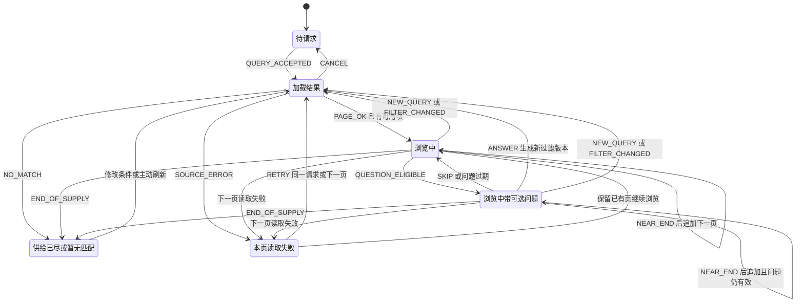

# 04 Discovery Engine 审核

## 当前路径与产品目标

【要求】输入“沙发”等简单商品名称，在固定聊天框发起，返回瀑布流，默认首批 20 件。排序结合相关性、确认偏好、当前会话需求和多样性。页量随有效浏览自适应。澄清可跳过。

【代码】`/discover` 服务端预载最多 100 条公开商品和最多 30 条发布内容，开发环境另有演示数据。发现页对已加载条目按收藏类别和拒绝记录重排。聊天有近期、关键词和 BGE 向量召回，规则结果和模型结果都限制最多三件商品。审查到的消费者路径没有以自然语言查询为键的 20 件分页、游标或动态问题控制器。[预载及发布内容](../../../app/discover/page.tsx#L148)　[重排](../../../lib/consumer-advisor/discovery-ranking.ts#L3)　[搜索计划](../../../lib/consumer-advisor/consumer-entry-workflow.ts#L310)　[返回约束](../../../app/api/consumer/assistant/route.ts#L437)

【代码】公开视图要求目录、店铺、渠道有效，关联可见且至少有一个小红书或抖音链接。关键词检索用词表扩展及 `ilike`，先按创建时间限量，再在应用层排序。公开候选来自平台已发布投影。开发演示商品不代表可用外部供给。[可见条件](../../../supabase/migrations/20261025132000_discover_product_types.sql#L51)　[关键词检索](../../../lib/storefront/service.ts#L529)

## 【假设】请求、排名和页量

1. Gateway 给 Discovery 传可校验的 `querySpec`，包含实体类型、确认的类别和约束、明确排除项、引用版本和范围。候选从同一公开发布投影检索。按实体或销售条目 ID 做去重，索引命中后回查当前可见性。用户当前显式约束优先于长期偏好。
2. 先过滤权限、类型、材料排除、可用性和明确预算。预算使用金额及币种和必要的时间点。价格未知、询价、已确认免费分别表示。缺少可比较价格时保留在可标注的探索区，严格预算请求只展示可证实满足条件的条目。
3. 先以短语、类别与关键词为基线。向量在独立预算内作为候选补充，归并使用 RRF 或经评估的混合分数。再以本轮软需求及确认偏好小幅重排。相关性低于门槛或违反硬条件的条目不得靠画像加分进入首屏。最后以店铺、款式和类别多样性做受限重排，供给稀缺时降低多样性配额并报告真实数量。
4. 返回 `items, searchRunId, nextCursor, hasMore, appliedConstraints, dataStatus, contextRevision, evidenceRefs`。首批上限 20 且只返实际可用数量。游标绑定查询摘要、权限范围、排序或索引版本、上下文版本和稳定的排序断点。实现可用有限候选快照或键集分页，避免可变集合上的裸 offset。后一页回查下架及权限变化，去重并维持已展示次序。条件或长期偏好版本变化时新建搜索运行，忽略旧响应，保留已看列表至用户切换。
5. 把首批 20 当产品默认值，评估首屏图片字节数、LCP、实际供给和首批有效互动。预取下一页由接近末端、网络和未完成请求共同触发。只有多次达到有效浏览阈值且加载稳定时提高下一页上限。快速滑过意味着需要更多观察，不能当作拒绝。低带宽或内存压力可收小后续页。试点规则可从最近两页的有效浏览比例均超过 60%、用户确实接近末端且图片预算充足时取 24 件开始。慢网或图片预算不足时取 12 件，其余取 20 件。少量曝光时保留默认值。这些阈值与页量作为实验参数。

### 观测、提问及衡量

- 记录 `impression`、`engaged_view`、`open`、`save`、`compare`、`explicit_reject`、`near_end`、`answer`、`skip`、`reformulate`。去重键为搜索运行、条目与事件序号。有效停留可从“可见面积过半、前台持续至少一段时间”开始校准。初次实验可用 1.2 秒作种子，随后按设备和卡片形态评估。完成率分母只含实际展示项。停留需结合打开、收藏、比较和再次查询判断。
- 在缺少会改变结果的条件且候选覆盖足够时生成问题。候选问题来自结构化字段，如材料、尺寸或场景。先排除本轮、已确认档案或最近已跳过的字段。计算各选项下的候选数及 top K 差异。只在至少两个可行选项能实质改变排序或满足约束时给一个可跳过建议。试点以两个选项 top 10 的交集除以并集衡量相似度，低相似度且每个选项都有有效候选时优先考虑。用户继续滑动无需回答。跳过只记冷却和未知。用户主动提问可打破冷却。
- 按会话衡量有效发现率、无结果率、预算或排除项违规率、重复改写率、商品详情与比较完成、显式满意度，以及 top K 店铺和样式覆盖。跟踪问题接受、跳过、问后是否改善排序、是否造成中断。分匿名与授权个性化、供给稀缺与充足、设备网络、品类做对照。点击率与停留各只代表部分信号。

## 【假设】Discovery Controller 状态机

| 输入事件 | 转换与输出 |
| --- | --- |
| `QUERY_ACCEPTED` / `NEW_QUERY` | 建立新运行，取消或忽略旧页响应。发送首批 20 件结果事件 |
| `PAGE_OK` / `NEAR_END` | 每个游标只在途一次。检查版本、去重、追加或回放已接收页。缺少新库存进入供给已尽 |
| `IMPRESSION` / `ENGAGED_VIEW` / 明确反馈 | 聚合本次运行信号。用会话条件影响下一页。产生问题候选或单独的长期提案信号 |
| `QUESTION_ELIGIBLE` / `ANSWER` / `SKIP` | 问题保持非阻塞。答复更新该次查询条件和版本，跳过保留游标、抑制重复邀请 |
| `CONTEXT_REV_CHANGED` / `FILTER_CHANGED` | 下一轮或明确刷新按新快照排序。已浏览结果标识旧修订，撤销权限时立即去除相关项 |
| `SOURCE_ERROR` / `RETRY` | 可选向量失败保留关键词结果，目录失败明确提供重试。已有页保持可读。重复请求复用请求 ID |
| `NO_MATCH` / `END_OF_SUPPLY` | 明确真实数量、已用条件和可选修改动作。不补造商品，不自动放宽硬条件 |

## 【问题】发现

### DISC-01 P1 聊天推荐和可分页发现未建立合同

- **问题与依据** 发现页预载大批最近发布数据，聊天返回至多三件匹配，二者分别排序。普通名词输入没有创建可续取结果运行的路径。[发现页](../../../app/discover/page.tsx#L148)　[规则短路](../../../app/api/consumer/assistant/route.ts#L335)　[聊天结果](../../../app/api/consumer/assistant/route.ts#L449)
- **实际影响** “沙发”可能只得到少量聊天卡片，继续浏览时回到无关目录。供给不足时无法区分库存、检索召回不足和数据故障。
- **推荐修正** 增加由同一会话事件触发的发现分页合同，发布投影作为统一候选源。以 20 件首批、真实供给与稳定游标验收。
- **替代与取舍** 客户端过滤预载数组实现快，但只覆盖已有快照。分页和回查需要服务端合同，可避免漏项和失效条目。
- **阻塞范围** 阻塞自然语言发现试点。

### DISC-02 P1 向量请求同时执行索引更新

- **问题与依据** 向量查询先领取并尝试索引最多 24 个商品，再为查询启动 Python/ONNX 子进程。进程加载本地绝对路径模型并可等待 45 秒。新发布事件重置任务锁，现有完成路径按商品 ID 删除任务，旧任务完成时可能删除新事件。迁移已提供租约领取原语。[索引和查询路径](../../../lib/consumer-advisor/consumer-catalog-vector.ts#L27)　[模型进程](../../../lib/consumer-advisor/local-bge.ts#L9)　[排队与领取](../../../supabase/migrations/20261108140638_consumer_bge_vector_retrieval.sql#L45)
- **实际影响** 首屏时间与积压耦合，部署缺模型或依赖会降级，旧向量可能长时间滞留。查询量一高会重复加载模型并争用在线实例。
- **推荐修正** 线上查询只读索引并按子预算执行。索引由独立执行周期领取版本化任务，按租约和源版本确认完成，旧版本结果不能覆盖或删除新任务。验证模型在目标环境的封装、冷启动、候选覆盖和失败后关键词降级。
- **替代与取舍** 首期仅关键词可以更早验证 20 件分页和排序。常驻嵌入进程或托管嵌入降低冷启动，增加常驻成本或外部数据传输。待实际收益与部署限制明确再选。
- **阻塞范围** 阻塞生产语义召回。关键词发现可独立试点。

### DISC-03 P1 价格及排除约束未贯穿召回与排序

- **问题与依据** 预算为数值，聊天与向量 SQL 对原始价格比较。公开投影有币种，但聊天候选省略币种。投影取最早的变体，映射将缺价转为零且可能标记免费。自由文本正则未提取统一否定字段。[价格投影](../../../supabase/migrations/20261025132000_discover_product_types.sql#L14)　[映射](../../../lib/storefront/service.ts#L572)　[聊天候选](../../../app/api/consumer/assistant/route.ts#L260)　[向量价格](../../../supabase/migrations/20261108140638_consumer_bge_vector_retrieval.sql#L191)
- **实际影响** 多币种或询价商品可能误入严格预算，否定条件和可购买性在召回、重排和模型输出中各自解释。
- **推荐修正** 以类型化报价状态、金额币种、可用变体和适用条件作为硬过滤。对比及推荐引用带版本的有效报价，并在返回前复查。
- **替代与取舍** 首期仅允许单币种比较，边界清晰但供给覆盖更窄。增加 FX 快照需选择来源、时效和舍入规则，待确认。
- **阻塞范围** 阻塞跨币种和硬预算的生产承诺。

### DISC-04 P2 浏览信号与问答尚无可验收规则

- **问题与依据** 发现重排取收藏、拒绝与收藏同类分数。当前可见界面和查询合同没有有效停留、候选差异、问题冷却或可重放反馈事件。[排序规则](../../../lib/consumer-advisor/discovery-ranking.ts#L3)　[页面排序入口](../../../components/consumer-market/screens/HomeScreen.tsx#L44)
- **实际影响** 以滑动完成率判断兴趣会反复追问或过早放量。只强化同类偏好会减少探索多样性。
- **推荐修正** 使用上述事件、对照指标和候选差异检查，先试点固定页量，再验证自适应与问题是否改善搜索。
- **替代与取舍** 固定 20 件与手动过滤最可预测，可作为控制组。大模型随意生成题目灵活，但较难保证问题可改变排序。
- **阻塞范围** 阻塞自适应放量。固定分页可先上线试点。
