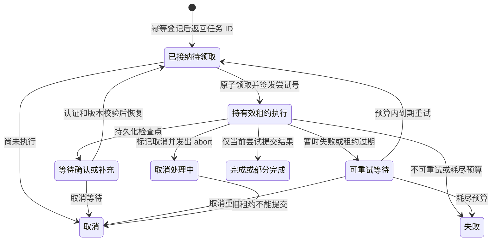

# 05 Mastra Execution Engine 审核

【要求】Mastra 用于多步骤编排、工具调用或动态规划。简单发现直接交给 Discovery。固定评测通过同一会话入口。

【代码】早期调研已比较 Mastra、LangGraph 和界面呈现层。仓库还保留个人顾问任务表及任务类型。它们与当前消费者助手的活动调用路径分别审查。[早期调研](../../research/adaptive-agent-workflows.md#L13)　[顾问任务表](../../../supabase/migrations/20261019120000_create_consumer_advisor_tasks.sql#L1)

【代码】锁定 Mastra Core 1.82.0。当前活动消费者代码使用四个 Workflow 包装规则分流、混合召回、候选计划和记忆校验，`createRun` 都禁用快照持久化。模型请求由 provider 封装直接发送。审查到的活动路径没有 Mastra `new Agent` 或 `createTool` 注册。仓库另有 MCP 目录工具原型和商家技能调用记录，均不构成已接通的消费者 Agent 工具运行时。[版本](../../../package-lock.json#L1831)　[Workflow](../../../lib/consumer-advisor/consumer-entry-workflow.ts#L83)　[任务与校验](../../../lib/consumer-advisor/consumer-entry-workflow.ts#L344)　[调用模型](../../../app/api/consumer/assistant/route.ts#L411)　[MCP 原型](../../../mcp-server/server.mjs#L35)

## 【假设】能力归属

| 能力 | 默认运行方式 | 何时提升至 Mastra |
| --- | --- | --- |
| 鉴权、配额、语义分类、任务路由 | Gateway 和小模型适配器。确定的界面动作使用结构化命令 | 分类与授权保持在 Gateway，编排接收已经授权的计划 |
| 商品发现、逐页浏览、成分查询 | 普通 TypeScript 和 SQL。对接用户可见的发布投影 | 当发现是更大任务的一个依赖时复用同一个只读接口 |
| 确定对象的结构化比较 | TypeScript 读取获准的实体与报价，按字段比较。解释按需一次模型生成 | 需要跨来源资料提取、事实核验或并行对比时用已知 Workflow |
| 购物评测和记忆确认 | 状态机、规则评分和事务命令 | 流程引擎可发出评测结果事件，正式写入始终由个人上下文命令执行 |
| URL、PDF、图片识别 | 独立验证与提取服务。单输入且无需恢复的短任务在预算内运行 | 跨资料依赖、复杂多模态合成或长任务采用 Workflow 和受限工具 |
| 图像生成和多张结果 | 模型适配器与对象存储。任务记录管理预算、对象和结果来源 | 耗时或重试不可预测时用持久任务，Workflow 管理提取、生成、汇总与取消 |
| 未知步骤的研究或跨域组合 | 先尝试有限计划和受控 Workflow | 只有固定步骤无法表达且评估有收益时，使用少量领域 Agent，并设最大工具次数、并发数、Token 与时限 |

Workflow 的分支和恢复条件可检验。Agent 在已分配权限和费用预算内选择步骤。Tools 是有输入输出 schema 的执行适配器。权限由服务器的 `Principal`、目标实体、版本、允许动作与预算决定，每次工具执行时复核。模型输出不能修改这些字段。需要用户确认的写入采用独立命令及修订校验。短纯函数可直接测试，必要时再包成 Workflow 步骤。[Mastra 工具定义](https://mastra.ai/docs)　[Mastra 工作流控制](https://mastra.ai/docs/workflows/control-flow)

## 【假设】长任务生命周期

- 接纳事务写入 `jobId`、主体、允许能力、输入哈希、依赖引用、截止时间、预算和尝试号。按任务 ID 与步骤键幂等记录产物。worker 原子领取并续租，租约过期时可恢复。通过 `seq` 重放进度。先持久化执行记录再异步调度，确保提交后可恢复领取。短任务用请求截止时间与取消信号即可。
- 在供应商调用前检查取消与预算，传递 `AbortSignal`。完成时按取消标记和尝试号 CAS，晚回结果不覆盖最终状态。上游若不支持取消或幂等，已发起请求可能产生费用，重试前根据调用记录与供应商状态判定。区分可重试暂时故障、无权限、无效输入和供应商已接单但回执未知。
- 任务快照记录工作流版本、可恢复位置和证据引用。避免写入模型密钥、附件明文或完整个人档案。Mastra 持久存储可保存 Workflow 快照，产品任务的授权、幂等、公开状态和结果仍需明确所有者。使用当前锁定版本先验证恢复和取消合同，再决定是否使用持久 Mastra 适配器。[Mastra 存储](https://mastra.ai/docs/storage)
- 使用现有 Postgres 租约表做小规模验证。实际有轮询积压、重试运维或吞吐要求时对比 Supabase Queues 与专用队列。消息可重投时仍需要幂等消费者与恢复策略。[Supabase Queues](https://supabase.com/docs/guides/queues)

## 【问题】发现

### RUN-01 P1 执行范围与工具权限未成为契约

- **问题与依据** 现有工作流接受输入与校验结果，没有 Agent 工具授权层。原图若把简单发现也交给通用 Agent，会与 Gateway 和 Discovery 的决策重复。[Workflow 输入](../../../lib/consumer-advisor/consumer-entry-workflow.ts#L19)　[Workflow 调度](../../../app/api/consumer/assistant/route.ts#L203)
- **实际影响** 平行分流出现策略差异，工具调用数量和数据范围难预测。将来若工具可写，提示词无法保证权限。
- **推荐修正** 工作流只执行批准的任务。注册可观察的最小工具集，授权在每次执行时由受信主体和资源策略校验。生成结构化对比和可呈现结果，UI 自行渲染。
- **替代与取舍** 普通 TypeScript 足以覆盖简单功能，调试成本低。可恢复的已知任务适用 Workflow。动态 Agent 只在可测收益超过成本时启用。
- **阻塞范围** 阻塞 Agent 工具公开和商家插件执行，简单读能力可先独立验证。

### RUN-02 P1 长任务缺少耐久、取消与费用边界

- **问题与依据** 消费者 Workflow 关闭快照持久化。商家知识助手同步执行后写 `ai_jobs` 记录。图片内容包在请求中先提取、再依次尝试四张图片，异常回退到素材预览，接收的参考图未传入生成调用。[快照设置](../../../lib/consumer-advisor/consumer-entry-workflow.ts#L145)　[记录与响应](../../../app/api/knowledge/assistant/route.ts#L183)　[图片服务](../../../lib/content-generation/service.ts#L41)
- **实际影响** 客户端断开或进程重启时无法恢复或查询完整进度。重试可能重复计费，生成失败和缺配置可能被归成同一种回退。
- **推荐修正** 先用持久任务记录、租约、幂等步骤、明确降级与取消合同。图片以对象 ID、状态和证据返回。为每个任务限制图片数、耗时、调用次数和费用。
- **替代与取舍** 同步模式适合低风险短调用，保留明确的请求截止。Postgres job 较简单，托管队列有独立运维与重投机制。按试点执行时间和积压选择。
- **阻塞范围** 阻塞长任务、图像生成规模化及需要恢复的工作流。

### RUN-03 P1 URL 与附件需独立的信任和取证边界

- **问题与依据** 消费者引用由客户端拼接到消息。图片和 PDF 有格式分支，提示词把附件当资料，但在消费者执行路径未见通用网页抽取与来源版本。商家知识上传已有扫描和隔离路径，属于不同入口。[引用拼装](../../../components/consumer-market/components/FeedChatDock.tsx#L165)　[附件解析](../../../app/api/consumer/assistant/route.ts#L83)　[隔离上传](../../../app/api/knowledge/uploads/route.ts#L45)
- **实际影响** 一旦给工具任意 URL、跨用户对象 ID 或外部文本指令，可能出现 SSRF、越权读取与错误归因。难以复现对比所依据的版本。
- **推荐修正** 服务端解析受授权引用，对外链做协议、域、DNS/IP、重定向逐跳、字节和时间检查。下载器隔离网络权限，拒绝私网、元数据地址和非批准协议。附件在私有存储与隔离解码下处理，内容只作为证据，记录来源、抓取时间、版本与可见范围。输出的实体与证据 ID 要回查。
- **替代与取舍** 只支持上传或批准域，限制范围但风险与运维更小。开放抓取需要网络隔离、抓取政策和异常观测。
- **阻塞范围** 阻塞任意 URL 获取和新附件处理工具。[OWASP SSRF 防护](https://cheatsheetseries.owasp.org/cheatsheets/Server_Side_Request_Forgery_Prevention_Cheat_Sheet.html)　[OWASP Prompt Injection](https://genai.owasp.org/llmrisk/llm01-prompt-injection/)
