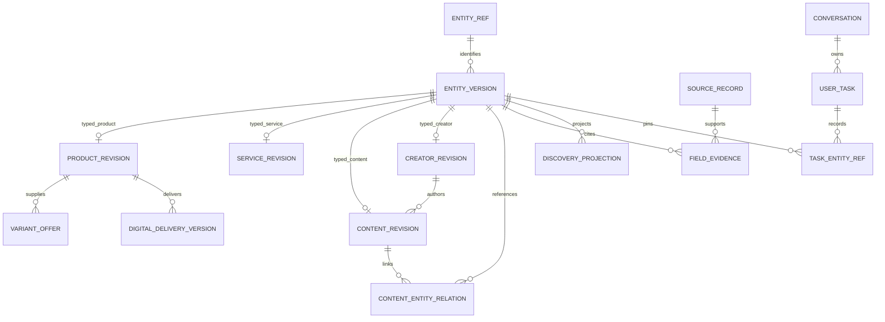

# 06 Unified Information Model 审核

【要求】原图确认统一表达商品、服务、内容、创作者、来源与真实性、实体关系。活动、场景、地点和统一模型的最终范围仍待确认。

【代码】目录已有 `catalog_items`、`catalog_variants`、`catalog_item_channels`、类目字段定义、属性和来源表。属性有来源、置信度与审核状态。目录条目混用 product/service/skill 类型，部分交付、分类、链接等信息来自 `details`。内容已独立建表，但通过 `product_ids` 数组与商品相连，Discover 依赖本次预载商品才能组装内容。公开视图的部分字段来源于原始目录 JSON。商品能力发布接口明确阻止尚未接通交付的数字能力上架。[目录与渠道](../../../supabase/migrations/20261003053000_catalog_asset_semantic_channels_orders.sql#L7)　[来源与属性](../../../supabase/migrations/20261007090849_catalog_pim_and_storefront_generation.sql#L67)　[内容](../../../supabase/migrations/20261022015120_creator_content_posts.sql#L1)　[发现组合](../../../app/discover/page.tsx#L165)　[能力发布](../../../app/api/merchant/products/%5Bid%5D/publish/route.ts#L21)

【代码】早期数字能力设计稿已建议将能力版本、购买权益和连接授权分开。当前发布路由的交付限制仍在。将旧设计当作领域候选，不据此认定消费者已能运行商家技能或插件。[数字能力设计稿](../../architecture/consumer-capability-database-design.md#L3)

## 【假设】三个候选模型

| 维度 | A 商品中心 | B 统一实体引用与类型专属模型 | C 用户任务中心 |
| --- | --- | --- | --- |
| 商品规格、变体、报价 | 与现有表兼容，适合商品先行 | 复用目录和 SKU，发布版本与报价各有约束 | 适合保存一次比较的引用和价快照，权威商品结构需要外部模块 |
| 数字产品、服务 | 易把权限、预约和交付塞进商品细节 | 可售数字商品保留报价，交付版本和权益独立。服务有服务范围、位置、时段与预约条件 | 一次需求可组合服务与商品，无法稳定表达供给及交付权威 |
| 内容和创作者 | 无 SKU 的内容及作者只能附属于商品或店铺 | 内容、发布版本、创作者主体各有独立身份。内容与条目按关系关联 | 引用适合个性化组织，独立出版、作者关系和署名仍需实体 |
| 外部数据及真实性 | 可利用已有目录来源，但跨领域来源容易混为商品字段 | 通用来源标识与字段级证据。公开投影只暴露获准事实 | 每次任务可保留当时来源，任务间共享和冲突治理会重复 |
| 冲突、修订和撤回 | 商品内可控。多来源及跨域字段需不断加 JSON 约定 | 同一实体允许多个源断言，审核选定有效版本，保持旧版本和撤回关系 | 历史快照好追溯，无法自然回答当前哪些字段仍有效 |
| 语义检索与查询效率 | 单类目录和既有向量最直接，扩类型后过滤难统一 | 各类型有结构约束和索引，共用版本化搜索投影。投影维护有成本 | 任务信息多为私有，跨任务公共发现不宜扫描任务日志 |
| 个人上下文关联 | 容易只保留商品 ID 和标签，难表示内容、创作者或服务 | 记录用户范围、带类型实体引用和当前会话约束，私有上下文独立 | 任务相关性表达最强，长期资料与公共数据需另有权威 |
| 迁移与扩展 | 适合短期复用，跨类型后兼容层和重复条件增长 | 小步增加共享引用和读投影，保留领域约束。若过早做通用关系图会增加维护 | 可先做聊天历史和任务重放，作为全局数据模型会让同一事实被多份任务复制 |

推荐 B 作为信息合同，保留 A 的目录和 SKU 写模型，并用 C 存会话与任务的引用及快照。第一阶段可先定义共同的 `EntityRef` 和类型化公开投影。是否需要新的实体注册表，取决于实际跨类型外键与权限一致性需求。[待决范围](08-open-decisions.md)

## 【假设】共享和专属字段

| 对象 | 权威字段 |
| --- | --- |
| 共享实体引用 | 稳定 ID、类型、归属主体、可见范围、版本指针、生命周期。展示标题、缩略图和摘要可在公共投影复用。登录账号与发布主体是不同概念 |
| 商品与报价 | 商品事实、规格、类目受约束属性。SKU 变体有价格、币种和可用性。渠道或店铺销售关系独立表示，价格快照含时点与状态 |
| 数字交付 | 可售条目、不可变的交付版本、使用权、连接授权分表。公开说明仅暴露描述，密钥、答案、私有工作流和任务结果在各自范围 |
| 服务 | 服务定义、提供方、地区与交付方式。时段、容量、预约规则及报价是专属结构 |
| 内容与创作者 | 创作者/组织身份、内容的草稿与发布版本、授权、媒介和作者关系。连接商品或服务通过带关系类型的关联行，有顺序与引用版本 |
| 来源与证据 | 来源身份、获取时间、内容哈希、可用权限及原始记录引用。字段证据关联来源与实体版本，记录断言、审核人、置信度与适用时间 |
| 搜索投影 | 已发布版本的检索文档、语言、字段、作用域、索引版本和有效时间。向量记录模型、维度、内容哈希、源修订和状态 |
| 任务与个人上下文 | 会话、任务、结果和证据引用固定使用时的版本。用户个人资料在自己的权限域。搜索或对比的输入可随版本追溯 |

对同一字段分别保存来源断言与选中的正式事实。比如商家确认的沙发材质为布面，外站称为真皮。系统应保留两条带时间的断言，把冲突交给审核，在此期间可公开确认过的字段或显示未知。来源失效应撤回相关读投影。模型抽取写入待复核断言。商品实体 ID、销售渠道条目 ID 与商家发布方各自稳定。首期以来源内部 ID 去重，跨站是否同一实体需单独决策。

JSON 适合版本化的内容块、少量扩展字段或原始载荷。可过滤、排序、权限校验和外键关联的字段放在固定列或类型专属受约束的属性表中。一个版本对应一种实体类型，数据库或受控事务校验所属类型与组织。内容关联要检查当前可见性，跨发布主体的引用按产品规则授权。

### 概念 ER 图

【假设】ER 图表示目标关系。共享引用可映射到现有商品、变体和内容表。先将商品搜索的公开字段、版本和证据合同冻结，再接一个有独立身份的内容类型验证。供给进展决定服务和其他扩展类型的优先级。

## 【问题】发现

### MODEL-01 P1 商品形状限制内容与服务扩展

- **问题与依据** 目录混用条目类型与交付类型，多个结构字段来自 `details`。Discover 以预载商品 ID 组装内容，缺少任一关联即丢弃该内容。创作者记录与门店、Auth 作者绑定，缺少面向多类型引用的统一契约。[公开投影](../../../supabase/migrations/20261025132000_discover_product_types.sql#L16)　[内容加载](../../../app/discover/page.tsx#L165)　[内容表](../../../supabase/migrations/20261022015120_creator_content_posts.sql#L1)
- **实际影响** 无商品的内容或服务难以独立出现。随着发布方、来源和履约类型增多，规则会在 UI、索引和数据库重复。
- **推荐修正** 落地共享引用和各类型写模型。目录和变体作为商品权威，内容版本与关系独立，服务试点先验证类型字段和权限。
- **替代与取舍** A 能缩短商品首版，但跨类型时会积累兼容逻辑。C 适合任务复现，供给仍需领域权威。直接建万能实体表虽统一读写，查询与约束成本随类型增长。
- **阻塞范围** 阻塞跨类型接口冻结与新域迁移。商品试点可复用现有目录。

### MODEL-02 P1 来源与可见版本未贯穿索引及结果

- **问题与依据** PIM 已有来源、审核与同组织外键。消费者向量记录仅按商品 ID 主键并保存模型、哈希，公开列表和聊天结果主要以商品 ID 表示，缺少一致的实体版本、字段证据与索引修订。[属性证据](../../../supabase/migrations/20261007090849_catalog_pim_and_storefront_generation.sql#L115)　[向量存储](../../../supabase/migrations/20261108140638_consumer_bge_vector_retrieval.sql#L4)　[结果校验](../../../app/api/consumer/assistant/route.ts#L109)
- **实际影响** 跨来源更新、价格冲突、下架和索引重建后，无法重现结果依据。未确认数据可能被读投影混入。
- **推荐修正** 保留 PIM 来源能力，给公开发布、索引和结果添加版本引用与可见性校验。回填建立旧 ID 对照。关键词投影与向量索引都支持按源版本替换和撤回。
- **替代与取舍** 全量复制原始记录进入搜索实现较快，权限和删除困难。按证据引用取详情需要一次受控读取，便于控制数据范围与更新。
- **阻塞范围** 阻塞跨来源检索、可验证引用及第二个实体类型的生产索引。
