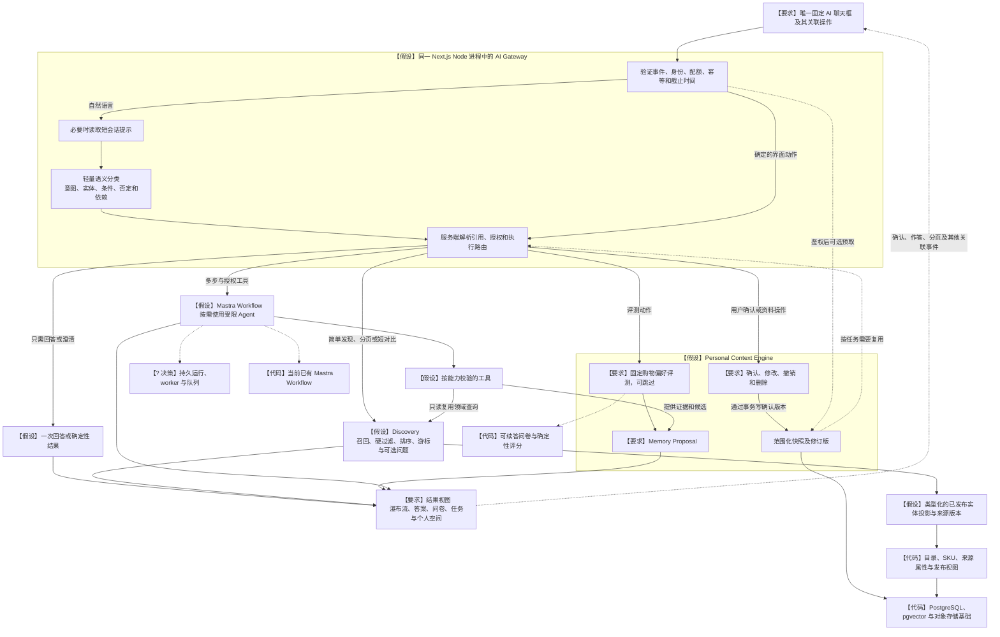

# 09 修订后的推荐架构

图中箭头表示请求、读取或结果的依赖，具体并发与超时以网关时序为准。【要求】为已确认产品约束，【代码】为现有实现基础，【假设】为未来设计，【? 决策】为实现选择待确认。

提案经结果视图交给用户。用户的确认动作沿固定会话入口或其关联操作进入 Gateway。候选生成、受控工具执行和正式写入分别拥有清晰的授权点。Discovery 直接处理简单发现，也可被 Mastra 作为只读能力调用。发现控制器建议问题或将反馈交给个人上下文命令，执行方向保持单向。

【假设】首期继续采用同一个 Next.js 部署，数据库和对象存储沿用现有基础。AI Gateway、Discovery、Personal Context、Mastra 是模块职责。Unified Information Model 通过类型、约束与投影共享。随着长任务接入，按实际资源隔离与恢复需求决定 worker 与队列部署。供应商模型位于权限和成本边界之后。[边界审查](01-architecture-boundaries.md)　[队列决策](08-open-decisions.md)

## 【假设】最小事件契约

| 事件或接口 | 必需字段和语义 |
| --- | --- |
| `submit` | 版本、请求 ID、会话 ID、已知回合修订、文本或结构化动作、附件与实体引用、页面线索。主体和权限由服务端根据会话解析 |
| `discovery.page` | 搜索运行 ID、查询版本、条目、当前约束、下一游标、供给和来源状态 |
| `answer` / `clarification` | 请求和会话、答案或需澄清的字段、证据引用、可选交互动作 |
| `assessment.question` / `memory.proposal` | 尝试或提案 ID、可验证版本、选项或差异、下一步动作。确认动作带预期修订 |
| `task.accepted/progress/completed/failed/cancelled` | 任务 ID、序号、状态、可用结果和来源。重连按序号回放。取消与完成按执行版本竞争 |
| 错误 | 可区分认证、权限、配额、数据源错误、无匹配、过期引用、版本冲突和重试。已返回的可读结果保留其来源和状态 |

事件协议可由同一路由与同一会话机制处理，签名上传及任务重连可由受控端点承载。单一入口约束由用户可见交互和服务端合同共同保证。

## 【要求】保留项

- 固定聊天入口和关联操作保留上下文连续性，结果可在瀑布流、详情和个人空间按需呈现。
- 评测的规则评分、逐题跳过和续答已有可复用实现。新增提案确认、修订与删除合同解决长期数据权威问题。
- 保留目录、SKU、已发布投影和现有 PostgreSQL 查询基础。pgvector 在语义检索通过目标环境验证后作为补充。
- 保留 Mastra Workflow 作为已知多步任务的编排选项。简单任务直接使用领域接口并复用其测试契约。[Mastra 控制流](https://mastra.ai/docs/workflows/control-flow)
