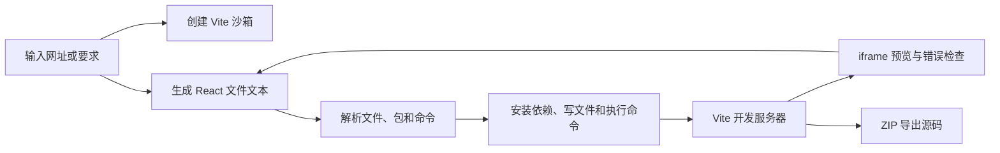

# Open Lovable 源码级复用评估

日期：2026-11-16  
上游：<https://github.com/firecrawl/open-lovable>  
审查提交：`806b8072f28afea11fa2b028cac1449eff74c511`  
对应目标：[AI 网站设计架构与边界](../ai-storefront-architecture-2026-11-16.md)

## 1. 结论

Open Lovable 可以作为生成、文件修改和开发预览链路的主要参考。**不能整仓接入 Omnilink，也不能把其当前开发预览当作生产店铺托管。**

本次尚无“生产接入时原样搬入即可”的完整业务模块。可优先提取文件分析、编辑上下文和 Provider 接口等局部代码；路由编排、租户状态和发布体系需要改造或新增。这不等于生成逻辑不能用，而是需要把它从单会话示例的运行假设中抽出。

依据为本次克隆的固定提交源码，不只依赖 README。未安装上游依赖、执行 npm 脚本、使用模型或沙箱密钥，也未运行其端点。以下结论是静态审查，不是已验证的商用部署结果。

## 2. 实际链路

源码中的主要位置：

- [生成页面](https://github.com/firecrawl/open-lovable/blob/806b8072f28afea11fa2b028cac1449eff74c511/app/generation/page.tsx#L548)组织创建沙箱、模型请求、应用文件与预览；该页面约 3,957 行，不能直接视作一个可嵌入 Omnilink 的独立编辑器组件。
- [generate-ai-code-stream](https://github.com/firecrawl/open-lovable/blob/806b8072f28afea11fa2b028cac1449eff74c511/app/api/generate-ai-code-stream/route.ts#L91)接收 prompt / model / context / isEdit，拼接生成与编辑提示，流式返回结果；文件约 1,895 行，包含多种搜索与上下文处理。
- [apply-ai-code-stream](https://github.com/firecrawl/open-lovable/blob/806b8072f28afea11fa2b028cac1449eff74c511/app/api/apply-ai-code-stream/route.ts#L264)解析结果、准备 Provider、安装包、写文件和执行命令；不是纯粹的“文本转文件”函数。
- [Vercel 脚手架](https://github.com/firecrawl/open-lovable/blob/806b8072f28afea11fa2b028cac1449eff74c511/lib/sandbox/providers/vercel-provider.ts#L325)和 [E2B 脚手架](https://github.com/firecrawl/open-lovable/blob/806b8072f28afea11fa2b028cac1449eff74c511/lib/sandbox/providers/e2b-provider.ts#L231)创建 Vite / React 应用。
- [create-zip](https://github.com/firecrawl/open-lovable/blob/806b8072f28afea11fa2b028cac1449eff74c511/app/api/create-zip/route.ts#L7)打包源码返回下载信息，且排除 dist / build 等目录，不能把这个导出包当作已验证的生产构建产物。

虽然脚手架 package.json 声明了 vite build，当前检查的主链路主要启动 npm run dev、操作 HMR 和预览。未发现完整“生产构建 → 不可变产物 → 审批发布 → 正式域名 → 回滚”的实现。

## 3. 模块映射清单

“可提取”表示局部代码复用候选，仍需保留许可证、适配依赖并补充测试；不表示已复制或验证。“需改造”表示复用思路或部分实现，不沿用现有端点作为生产入口。

| 上游部分 | 处理结论 | Omnilink 中承担的职责 | 接入前要做的工作 |
|---|---|---|---|
| [file-parser.ts](https://github.com/firecrawl/open-lovable/blob/806b8072f28afea11fa2b028cac1449eff74c511/lib/file-parser.ts#L6) | 可提取 | 文件清单与基本组件/导入分析 | 当前主要为正则启发式分析，不能当 TypeScript 编译器或权限验证器；限制大小并补充 TSX 边界用例 |
| [edit-intent-analyzer.ts](https://github.com/firecrawl/open-lovable/blob/806b8072f28afea11fa2b028cac1449eff74c511/lib/edit-intent-analyzer.ts#L6)、[context-selector.ts](https://github.com/firecrawl/open-lovable/blob/806b8072f28afea11fa2b028cac1449eff74c511/lib/context-selector.ts#L15) | 可提取并改造 | 根据修改请求选择相关文件和上下文 | 检查中文请求覆盖、固定数据 SDK 的保护和基准代码版本，不只按英语关键词匹配 |
| [SandboxProvider 接口](https://github.com/firecrawl/open-lovable/blob/806b8072f28afea11fa2b028cac1449eff74c511/lib/sandbox/types.ts#L35) | 参考并收窄 | 文件写入、命令结果、创建和销毁的 Provider 接口 | 网站领域不向普通请求暴露任意 runCommand；区分受控构建与开发预览 |
| [Vercel Provider](https://github.com/firecrawl/open-lovable/blob/806b8072f28afea11fa2b028cac1449eff74c511/lib/sandbox/providers/vercel-provider.ts#L325)、[E2B Provider](https://github.com/firecrawl/open-lovable/blob/806b8072f28afea11fa2b028cac1449eff74c511/lib/sandbox/providers/e2b-provider.ts#L231) | 需改造 | 隔离构建/预览的具体实现候选 | 改脚手架、文件根目录策略、依赖策略、任务关联、资源限额、错误处理；未证明适合长期生产 SSR |
| [生成路由](https://github.com/firecrawl/open-lovable/blob/806b8072f28afea11fa2b028cac1449eff74c511/app/api/generate-ai-code-stream/route.ts#L91) | 需拆分改造 | Omnilink 网站生成任务执行 | 提取模型输入与事件输出；移除 global 会话，注入授权资料、源代码基准和数据契约；支持取消、重试与持久化 |
| [文件/包/命令解析](https://github.com/firecrawl/open-lovable/blob/806b8072f28afea11fa2b028cac1449eff74c511/app/api/apply-ai-code-stream/route.ts#L24) | 可参考解析协议，需重写执行策略 | 受控文件变更集 | 模型结果只能成为待验证的变更建议；不直接安装任意包或执行任意命令 |
| [应用路由](https://github.com/firecrawl/open-lovable/blob/806b8072f28afea11fa2b028cac1449eff74c511/app/api/apply-ai-code-stream/route.ts#L264) | 需拆分改造 | 对指定项目版本应用文件变更 | 绑定 tenant / store / site / job；规范化路径、保护 SDK 与配置、检查基准摘要；应用成功才创建新版本 |
| [Morph Fast Apply](https://github.com/firecrawl/open-lovable/blob/806b8072f28afea11fa2b028cac1449eff74c511/lib/morph-fast-apply.ts#L180) | 可选，不作基础依赖 | 减少局部编辑输出量 | 需要额外 Morph 服务；加入版本冲突检查与合并验证，保留无 Morph 的文件替换路径 |
| [AI Provider Manager](https://github.com/firecrawl/open-lovable/blob/806b8072f28afea11fa2b028cac1449eff74c511/lib/ai/provider-manager.ts#L79) | 需改造 | 复用 Omnilink 已有模型配置策略 | 上游支持自定义 OpenAI-compatible 配置，但没有默认 DeepSeek 专用分支；不要把未知模型落到 Groq 的默认逻辑原样接入 |
| [iframe 预览](https://github.com/firecrawl/open-lovable/blob/806b8072f28afea11fa2b028cac1449eff74c511/app/generation/page.tsx#L1603)、Vite 日志检查 | 需改造 | 后台中的独立源私有预览 | 绑定租户和构建，增加短期预览访问授权、CSP、生命周期管理；iframe 本身不替代执行隔离 |
| [build-validator.ts](https://github.com/firecrawl/open-lovable/blob/806b8072f28afea11fa2b028cac1449eff74c511/lib/build-validator.ts#L12) | 只能作为诊断参考 | 构建及预览质量门槛 | 当前是 HTTP/HTML 字符串判断，且本提交调用点搜索仅见函数定义；不是已接通的编译和浏览器验证系统 |
| [ZIP 导出](https://github.com/firecrawl/open-lovable/blob/806b8072f28afea11fa2b028cac1449eff74c511/app/api/create-zip/route.ts#L7) | 可选参考 | 用户下载源代码 | 不承担正式发布；剔除凭据及私有资料，明确格式和大小限制 |
| Firecrawl 抓取、截图与品牌提取 | 可选参考 | 用户主动提供参考网站时的辅助资料 | 不是自有商品建站前提；外部页面视为资料，不能覆盖平台规则和数据契约 |
| [SandboxManager](https://github.com/firecrawl/open-lovable/blob/806b8072f28afea11fa2b028cac1449eff74c511/lib/sandbox/sandbox-manager.ts#L13)、[全局会话端点](https://github.com/firecrawl/open-lovable/blob/806b8072f28afea11fa2b028cac1449eff74c511/app/api/conversation-state/route.ts#L9) | 不复用其状态实现 | 用 Omnilink 持久化网站任务与租户范围状态替代 | 删除进程共享 activeSandbox / conversationState 等作为业务权威状态的做法 |
| 主页、装饰效果和重复 v1/v2 端点 | 不整体搬入 | Omnilink 使用自己的工作台入口 | 不引入第二套账号、主题、导航与冗余端点；按单一新链路接入 |

## 4. 阻止整仓接入的具体证据

### 4.1 全局状态和清理范围

- [SandboxManager](https://github.com/firecrawl/open-lovable/blob/806b8072f28afea11fa2b028cac1449eff74c511/lib/sandbox/sandbox-manager.ts#L13)只有全局 activeSandboxId，并由单例导出；Map 以 sandboxId 为键，未在该模块中建立商家/组织归属。
- [创建 v2 沙箱](https://github.com/firecrawl/open-lovable/blob/806b8072f28afea11fa2b028cac1449eff74c511/app/api/create-ai-sandbox-v2/route.ts#L21)在开头调用 terminateAll，再清理全局 Provider 与文件状态；错误清理也涉及整个管理器。共享进程中的不同商家不能接受这种生命周期范围。
- [生成路由](https://github.com/firecrawl/open-lovable/blob/806b8072f28afea11fa2b028cac1449eff74c511/app/api/generate-ai-code-stream/route.ts#L103)把聊天和编辑历史放在 global.conversationState；[会话读取端点](https://github.com/firecrawl/open-lovable/blob/806b8072f28afea11fa2b028cac1449eff74c511/app/api/conversation-state/route.ts#L9)直接读取这份全局状态。

这类状态在进程重启、多实例、并发请求下也不能作为可恢复任务账本。目标做法：数据库持久化 site/job/version 关系；沙箱句柄只作为已授权任务的执行资源引用。

### 4.2 操作接口缺少目标租户授权接缝

抽查 [run-command-v2](https://github.com/firecrawl/open-lovable/blob/806b8072f28afea11fa2b028cac1449eff74c511/app/api/run-command-v2/route.ts#L10)、[apply-ai-code-stream](https://github.com/firecrawl/open-lovable/blob/806b8072f28afea11fa2b028cac1449eff74c511/app/api/apply-ai-code-stream/route.ts#L264)、[create-ai-sandbox-v2](https://github.com/firecrawl/open-lovable/blob/806b8072f28afea11fa2b028cac1449eff74c511/app/api/create-ai-sandbox-v2/route.ts#L21)、[get-sandbox-files](https://github.com/firecrawl/open-lovable/blob/806b8072f28afea11fa2b028cac1449eff74c511/app/api/get-sandbox-files/route.ts#L10) 和 [conversation-state](https://github.com/firecrawl/open-lovable/blob/806b8072f28afea11fa2b028cac1449eff74c511/app/api/conversation-state/route.ts#L9)，处理函数直接读取命令、沙箱 ID 或全局状态，未调用 Omnilink 式的用户及店铺归属校验；本次仓库清单未发现统一认证 middleware。

这是“不能直接接入我们的多租户环境”的静态证据，不是对任何托管产品的实测漏洞结论。目标入口必须先确认当前用户与店铺，再解析属于该任务的沙箱；不知道 sandboxId 不等于有授权。

### 4.3 模型结果具有过多执行权

[应用路由命令执行段](https://github.com/firecrawl/open-lovable/blob/806b8072f28afea11fa2b028cac1449eff74c511/app/api/apply-ai-code-stream/route.ts#L692)逐项执行解析出来的命令；安装段合并请求和模型给出的包；[命令端点](https://github.com/firecrawl/open-lovable/blob/806b8072f28afea11fa2b028cac1449eff74c511/app/api/run-command-v2/route.ts#L10)把提交命令交给当前 Provider。

[normalizeProjectPath](https://github.com/firecrawl/open-lovable/blob/806b8072f28afea11fa2b028cac1449eff74c511/lib/morph-fast-apply.ts#L17)主要处理前缀和常见配置文件路径；不能把它当作已完成路径穿越防护或受保护文件权限控制。Provider 写入也支持绝对路径形式，需要由上层收紧目录范围。

目标做法：AI 输出文件变更集。平台验证允许的相对路径、文件类型、体积和不可修改文件，依赖来自锁定集合，构建命令由任务执行器固定提供。拒绝不合法变更，不在未经授权的部分自动回退到更宽权限。

### 4.4 开发预览不等于发布和 SSR

[Vercel 启动段](https://github.com/firecrawl/open-lovable/blob/806b8072f28afea11fa2b028cac1449eff74c511/lib/sandbox/providers/vercel-provider.ts#L527)运行 Vite dev server；[页面 iframe](https://github.com/firecrawl/open-lovable/blob/806b8072f28afea11fa2b028cac1449eff74c511/app/generation/page.tsx#L1603)直接展示沙箱 URL。脚手架有客户端 src/main.jsx 和 src/App.jsx；未发现符合我们目标的服务器渲染产物及正式请求路由。

目标要求的公开首屏 SSR、默认站点源、自定义域名、发布指针、回滚与 CDN 失效仍需新实现。沙箱供应商未来是否也承担正式运行，应经过单独选型，不能从已有 Provider 名称推导。

### 4.5 技术栈和配置存在差异

- 上游宿主 package.json：Next 15.5.27、React 19.1、Tailwind 3；当前 Omnilink：Next 16.4.5、React 19.2.8、Tailwind 4。
- 上游两套生成脚手架主要是 React 18 / Vite 4 / Tailwind 3 的 JS/JSX 应用；目标为受控 React + TypeScript 工程。宿主与生成项目本来可以不同版本，但不能通过共享 node_modules 就假定兼容。
- README 环境变量示例写 Vercel 默认，而 [SandboxFactory](https://github.com/firecrawl/open-lovable/blob/806b8072f28afea11fa2b028cac1449eff74c511/lib/sandbox/factory.ts#L8)不传配置时回落到 e2b。接入时必须显式选择 Provider，而不是依赖文档描述的默认值。
- 上游的用户密钥、模型路由和错误策略不直接替换 Omnilink 已有 DeepSeek 连接流程；新增网站生成任务需要独立的超时、用量和输出预算。

## 5. 需要新增而非从 Open Lovable 搬入的能力

| 新增能力 | 以 Omnilink 什么为基础 | 不能省略的验收条件 |
|---|---|---|
| 网站数据契约和 SDK | 现有 storefront DTO、公开/编辑商品读取 | 正式站仅公开数据；草稿只进入授权预览；数据变化不靠重新生成页面更新 |
| 源代码版本与任务记录 | 现有账号、店铺、组织归属与基础模型调用 | 基准版本冲突可识别；跨实例恢复；任务取消与重试不能覆盖新版本 |
| 构建记录与不可变产物 | 新的网站生成域记录 | 源码、依赖锁、编译器、数据契约版本可追溯；失败不替换线上 |
| 构建与发布验证 | 固定编译命令、静态检查及浏览器验证 | 商品事实绑定、公开/草稿隔离、SSR 首屏、404、错误与缺货行为有测试 |
| 原子发布与回滚 | 沿用 owner/admin 发布原则和原有站点标识 | 只有验证通过的产物可激活；回滚代码不回滚商品事实；旧站兼容 |
| 正式隔离运行 | 与后台分离的站点运行环境 | 生成的浏览器和服务端代码均拿不到后台会话、模型和数据库管理密钥 |
| 域名与访问映射 | 现有 store slug 和预留 custom_domain | 验证所有权、解析、证书、未知 Host 拒绝及正确租户绑定 |

## 6. 建议提取顺序

本表是后续实施顺序，不是本轮已开始写代码。

1. 先固化 StorefrontData v1、源代码变更集与构建清单；明确 AI 可写文件、可信入口和数据 SDK 保护范围。
2. 再把上游文件分析和上下文选择提取成小模块，通过目标接口测试，避免把约千行的 Route Handler 当成生成引擎。
3. 选择一个 Provider 接入受控 TypeScript 脚手架；暂不同时支持两家供应商。Provider 身份不由模型输出决定。
4. 接入持久化网站任务和受租户约束的预览，替换所有“当前全局沙箱”的概念。
5. 建设独立的构建产物、SSR 运行和发布链路，验证后再让生成网站替代现有 schema 渲染入口。

不建议另起一套完整 Open Lovable 应用给商家使用，再通过 iframe 把整个编辑器塞进 Omnilink。这会保留两套状态和发布入口，仍然无法自动接上固定商品源。

## 7. 许可与验证范围

上游 [LICENSE](https://github.com/firecrawl/open-lovable/blob/806b8072f28afea11fa2b028cac1449eff74c511/LICENSE#L1)为 MIT。后续实际复制代码需保留许可及版权声明。开源代码许可不代表 Firecrawl、Morph、模型调用、Vercel 或 E2B 运行服务无需配置或计费，本轮没有验证这些服务的生产合同和价格。

本次仅下载并阅读源码，没有运行上游脚本。源码列出的测试脚本、构建函数或 README 功能不自动计作已通过验收。没有连接模型、Firecrawl、Morph、沙箱供应商或真实商家数据。

对应 [结构化证据清单](open-lovable-source-evidence-2026-11-16.json) 记录固定提交、源码行号、27 个 API 路由的清单及全局状态引用信号。该清单是导航证据，不是自动安全扫描结论。
