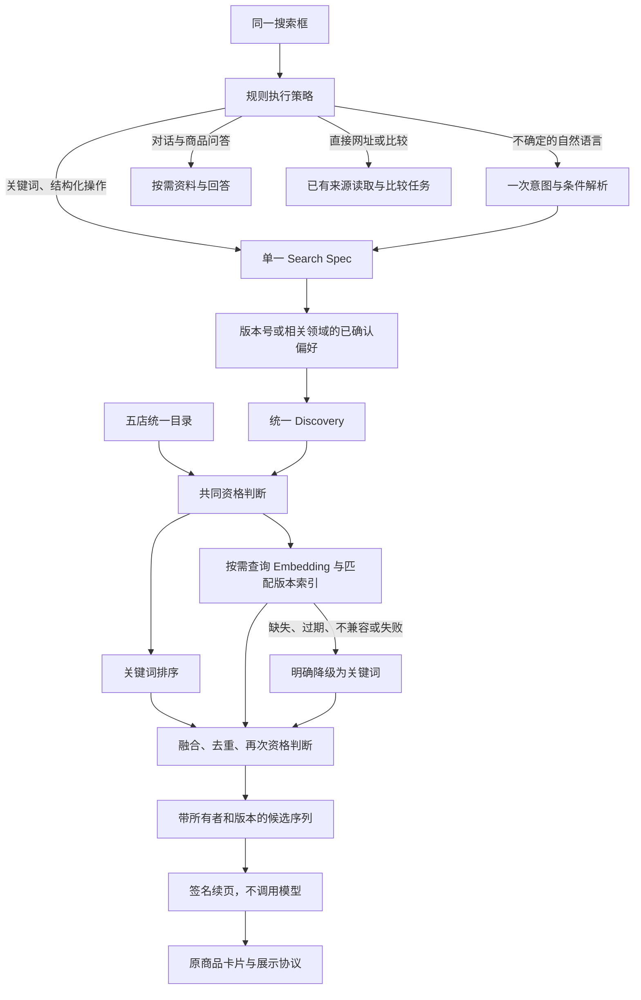

# P1 / P2 本地实施记录

基线：`main`，`31aab821739549f51f6330019e05b7b6166da5b1`。日期：2026-11-14。

本次为本地实现。未应用线上迁移、修改环境文件、安装依赖、提交或部署，也未执行真实模型调用。五店 35 条商品继续作为 demo 唯一商品来源。

## 已接线的执行链



### P1

- `execution-policy.ts` 对已知关键词、结构化搜索、比较、来源读取和附件先走规则。不确定或复合句交给一个解析器；“这款不要了，帮我找……”不会被提前当作商品问答。
- `discovery-contract.ts` 的 Search Spec 是条件来源。主路由删除了第二次预算解析、独立混合检索和历史商品绕过本轮条件的补入路径。
- `consumer-catalog.ts` 复用原五店 JSON，前后端读取同一目录；问答、比较和 Discovery 使用同一商品 ID。已核价记录归一化为 amount，五条未核价仍为 unknown。
- `eligibleConsumerProduct` 在召回前、融合后和每次续页执行：类型、必须条件、排除词、排除商品、价格模式、币种和价格范围。英文使用词边界；来源网址不作为商品属性匹配。
- 普通聊天不读取个人资料。需要个性化时，只读取相关领域最多 12 条已确认记录，传入回答最多 6 条。指代问题结合已选商品确定领域。只需失效检测时只读版本号。
- 关键词、明确类型筛选、风格选择、比较任务与续页无需生成模型。类型筛选走关键词；风格选择复用候选序列；续页不重新生成查询向量。
- 商品历史只保存搜索引用，游标继续绑定 run、session、context version 和过期时间。新查询与检索切换互相取消旧请求，旧响应不能覆盖新结果。
- 信息路径暂只查当前会话有权限的网页来源；未核验数据库商品和内容不会通过信息搜索旁路进入 demo。
- 直接网页读取保留原有 SSRF、防重定向和所有者校验，不强制入商品目录或建立向量。

### P2

| Profile | Provider / 模型 | 维度 | 预处理 | 索引版本 |
|---|---|---:|---|---:|
| bge-small-zh-v1.5-512-v1 | 本地 BAAI/bge-small-zh-v1.5-onnx-quantized | 512 | product-facts-v1 | 1 |
| qwen-text-embedding-v4-1024-v1 | Qwen text-embedding-v4 | 1024 | product-facts-v1 | 1 |

- 回答模型和检索模型独立。现有模型菜单增加自动、关键词、语义、混合，以及 BGE / Qwen Embedding。选择完成后点一次“应用”，才发起一次新搜索。
- 自动模式在没有风格语义条件时走关键词，有 sessionTerms 时尝试混合。语言不决定 Embedding Provider。
- 查询前检查 Profile 所有字段完全一致、状态 ready、全部合资格商品的向量和内容 hash 完整且最新。预检失败时不生成查询向量。
- 一次语义新查询只发一次 Embedding 请求，不自动重试。API 失败、索引变化等返回明确的降级代码和关键词结果；取消请求不伪装成成功降级。
- 结果记录 requestedMode、effectiveMode、完整 Profile、degraded、reason、Embedding 次数、输入 Token 和阶段耗时。Provider 没返回的用量保持未知，不估算成真实账单。
- 新派生表为 `consumer_embedding_profiles`、`consumer_catalog_vectors`，不是商品主表。旧 BGE 表和向量数据保留，不自动复制到新的预处理版本。
- 不同 Profile 可共存。新表定义了各自的 512 / 1024 维 HNSW 表达式索引；35 条 demo 的查询在硬过滤后的集合上做精确 cosine 排序，未声称 HNSW 加速已生效。
- 构建采用 Profile 行租约，按内容 hash 增量生成。BGE 每批最多 24 条，Qwen 最多 10 条。旧 token 不能写入或结束新构建；构建失败保留已有向量。

## 运行前提与命令

需要先按顺序审查并应用：

1. `20261114073613_consumer_unified_execution.sql`
2. `20261114073614_consumer_versioned_embeddings.sql`

本次没有把迁移应用到任何持久数据库。新搜索 RPC 未部署时接口会明确报错；不会把数据库不可用显示成零结果。旧搜索引用要求刷新。

默认只输出索引计划，不访问模型或数据库：

```sh
node scripts/consumer-index.mjs --profile qwen-text-embedding-v4-1024-v1
```

不调用模型的中英文关键词对照：

```sh
node scripts/consumer-index.mjs --evaluate --mode keyword
```

以下是后续操作者明确允许模型调用后使用的命令，本次未执行：

```sh
node --env-file-if-exists=.env.local scripts/consumer-index.mjs --profile bge-small-zh-v1.5-512-v1 --build --allow-model-calls
node --env-file-if-exists=.env.local scripts/consumer-index.mjs --profile qwen-text-embedding-v4-1024-v1 --build --allow-model-calls
node --env-file-if-exists=.env.local scripts/consumer-index.mjs --profile qwen-text-embedding-v4-1024-v1 --evaluate --mode hybrid --allow-model-calls
```

BGE 仍依赖 Python、ONNX 运行库和正确的本地模型目录。Qwen 复用现有 `DASHSCOPE_API_KEY`、`DASHSCOPE_BASE_URL`、`BAILIAN_WORKSPACE_ID` 连接配置；地域和 Key 必须相符。没有新增自动调度器；demo 修改商品后需显式重新构建，过期 hash 会触发关键词降级。

这是生成商品向量索引，不是微调或训练模型。Qwen 的 revision 明确标为 Provider alias，并不假装锁定供应商未公开的权重快照。更换模型、预处理、维度或供应商模型版本时应建立新 Profile 并重建，不能仅修改型号字符串复用旧向量。

## 验证证据

- 真实五店关键词对照：耳环 / earrings 各 19 件，项链 / necklace 各 7 件，戒指 / rings 各 8 件；每对结果及顺序相同，Embedding 调用均为 0。这验证词法基线，不代表真实 BGE / Qwen 语义质量。
- 硬条件测试包含未知价、免费、错币种、预算、必须词、排除词和融合后的非法 ID；35 条全目录按 20 + 15 续页，无重复。
- PostgreSQL 隔离测试验证 run 所有者、访客、会话、过期、上下文版本和领域读取权限。
- 索引控制逻辑测试使用 PGlite 的 real[] 向量 shim，执行原迁移控制逻辑并略去两条 HNSW DDL；验证 Profile 全字段、权限、空租约、过期接管、旧 token、原子写入和 hash 过滤。它不验证真实 pgvector、ANN 性能或跨连接锁竞争。
- 浏览器真实加载本地应用：1280px 与 390px 无横向溢出；两个选择控件高 44px；应用后选项保留；Escape 关闭菜单并把焦点归还模型按钮；Runtime exceptions 为 0。
- 浏览器竞争测试使用真实前端及模拟 HTTP：耳环刷新延迟期间提交项链，项链先返回，再释放旧耳环响应，最终标题仍为项链。所有真实消费者 API 和外网请求均被屏蔽。
- 全量验证：47 个测试文件、323 项测试全部通过；TypeScript 全项目检查通过；46 个改动源码与测试文件的 ESLint 无错误，保留 25 条既有警告；`git diff --check` 通过。

## 回退与暂未验证

- P2 回退：请求选择 keyword，或运维设置 `CONSUMER_RETRIEVAL_MODE=keyword`。保留目录、条件、分页、Profile 和全部向量，不清表、不删索引。
- P1 路由回退：`CONSUMER_RULE_ROUTING=off` 恢复自然语言分类入口，结构化操作保留；统一目录、资格判断、分页和所有者校验继续生效。
- 两份迁移是追加结构；回退应用逻辑时保留这些结构，不执行破坏性 down migration。
- 未实测真实模型响应、真实向量构建、真实 pgvector/HNSW 和部署区域网络。没有给中文或英文语义搜索质量打分，也没有改变 Gemini、图片生成或市场部署策略。

## 本次菜单的 antislop 交付检查

界面方向沿用现有搜索框，ENERGY / RHYTHM / MOTION = 1 / 1 / 1。保留既有配色、字体和布局，是为了让检索切换发生在原有模型选择位置；不增加素材、统计卡片或动画。

- Hard Gate PASS：新增控件有实际状态与请求连接，44px 点击高度，390px 无溢出，Escape 归还焦点；无新增虚构数据或宣传文案。
- Purpose Gate PASS：沿用原菜单表面和语义色变量；两种选择只用于测试者决定检索方式和向量模型，单次应用避免重复请求。
- Liveliness PASS：范围仅现有菜单，层级以“回答 / 检索 / 向量”分组，布局与动效强度保持既有方向。
- Craftsmanship PASS：实际运行应用并完成控件逐项操作，选项保留、取消、切换及过期响应场景均有浏览器证据。
