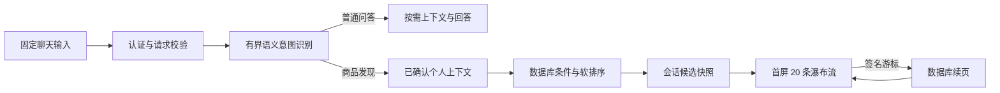

# Architecture V2.1 阶段 2、3 执行记录

日期：2026-11-12。继续阶段 0、1 的本地工作，不推送代码，不部署应用。

## 状态

搜索与个人上下文的代码、迁移、隔离数据库测试和浏览器验证已完成，所需迁移已应用到已连接的开发库。

目标为 `omnilink-dev`，项目 ID `fpypixbxsfpzrihwgmfk`。迁移后复核：公开商品 0 条，聊天记录 2 条，表内记忆 0 条，原有权限边界保留；未新增测试商品到开发库。应用文件为 `supabase/migrations/20261111030610_consumer_discovery_personal_context.sql`。仅执行这一项迁移，其他历史差异保留。

迁移确认后发现旧视图的价格列要求 `numeric(14,2)`，首次应用因类型不匹配而事务回滚；保留该精度并将其加入隔离测试后，重试成功。工具生成版本 `20261112145030` 通过官方 CLI 的 migration repair 对齐为仓库版本 `20261111030610`，该操作仅调整迁移登记。

本地服务端 Supabase 密钥无效，已从当前开发项目读取并验证已有 service-role 凭据，更新被 Git 忽略的 `.env.local`。公开密钥、项目密钥资源及用户数据未修改。实际 HTTP 搜索已成功返回空商品库，服务端角色的快照与候选 SQL 也通过验证。命令行直连 Supabase 会被重置，应用通过既有系统代理工作。

真实模型检查中，千问服务返回 `401 invalid_api_key`。现在按模型配置失败返回明确提示；需要更新有效密钥后才能验证真实语义路由及回答质量。不能将隔离测试的成功解释为完整线上链路或性能已验证。

## 阶段 2：统一输入到商品瀑布流



- 文本输入先经过语义分类，区分普通问答、发现、商品问答、对比和任务。分类无效时返回错误，不退回关键词猜测。图片与文件由明确的附件类型进入分析流程。
- 普通问答不读取商品目录；仅在需要个人信息时加载个人上下文。分类仅带本轮输入、最近两条简短上下文与上一搜索主题，不带完整目录、评测或记忆。
- 分类最多输出 512 tokens，8 秒预算，单次请求；DeepSeek V4 Pro 的分类使用同账号 Flash，无平台密钥兜底。商品发现成功后由真实数据直接组装响应，不再调用模型润色。
- `DiscoverySpec` 规定品类、同义词组、排除词、币种、当前预算和本轮软偏好。数据库执行筛选；长期偏好只影响顺序，不生成硬约束。
- 服务端只查询公开发布的商品投影，排除隐藏、草稿、非活动渠道、已删除店铺和无效外链。价格区分金额、免费、询价、未知；有预算时排除询价和未知价格，并核对币种。
- 首屏最多 20 条，快照最多 1000 个候选，15 分钟有效。不是全库总数，也不承诺空库有 20 条。
- 续页按快照顺序读取，重新检查商品是否仍公开；跳过下架项并向后补齐，新增商品不会插入旧快照。签名游标同时绑定会话、搜索、偏好版本、位置和时效。
- 账户由服务端验证；访客使用 HTTP-only 随机 cookie 的哈希。快照和读取 RPC 只供 service role 使用，数据库再次校验归属。
- `/api/consumer/discovery` 支持 start、page、resume、refine、skip-question。续页、恢复和刷新不调用模型。错误与零结果分别表示；失败页保留已经加载的商品。
- 客户端按会话保存页面并拒绝过期响应。聊天历史只保存搜索引用，不把完整商品页重复写进 localStorage 或历史字段。新会话不会继承旧搜索结果。
- 旧向量检索入口已移除同步索引批处理。检索只读已有向量，索引函数保留为独立入口，调度器仍属于后续阶段。

## 阶段 3：个人上下文、评测与记忆

- `PersonalContextResolver` 通过单条 SQL 快照取得版本和已确认记忆。提案、拒绝项与未确认资料不参与推荐。输入模型的相关记忆最多 6 条；商品发现仅使用有限的偏好词进行软排序。
- 个人记忆界面支持读取、手动保存、审阅提案、确认、修正、拒绝和删除。读取故障不显示为空档案，版本冲突要求重新读取。
- 购物评测支持键盘选择、跳过、暂停、续答、完成和重测。评测与记忆界面在主页工作区打开，固定聊天输入保留。
- 完成评测只创建提案。原始答案、跳过项、版本和答案指纹作为依据保留；同一结果重放不产生重复提案，也不会覆盖用户已经修正的记忆。
- 重测结果可有相同可见摘要，但保留各自的证据。新结果确认前旧正式结果仍有效；确认时在同一事务中替换旧完整评测、失效依赖推断并递增版本。
- 修正保留原始文本、来源和答案，停止应用旧的派生偏好词。推断来源不会因用户确认而改成事实或自述。
- 正式记忆变更通过数据库触发器递增账号上下文版本。旧续页返回 409，客户端清理该账号其他会话中的旧缓存并刷新当前查询，不重新调用意图模型。
- 搜索附加的可跳过风格问题先更新本轮排序；长期保存仅生成待确认提案，不自动写入正式记忆。
- 明确的开发预览将记忆保存在本机并显示提示；普通访客不能被误认作已登录账号。Provider 使用验证后的用户 ID，账户变更时重新建立会话与结果状态。

## 验证

- `npm test -- --reporter=dot`：34 个测试文件，183 项通过。
- `npx tsc --noEmit --pretty false`：通过。
- 修改文件的 ESLint：无错误；既有图片和 effect 规则仍有 warning。
- `npm run build`：通过。既有 middleware 弃用和本地 BGE 进程的构建追踪警告保留，未伪装为已消除。
- PGlite 执行实际 PostgreSQL 迁移、角色权限、RLS、事务和版本触发器；覆盖 20/20/5、下架补位、稳定快照、预算与价格缺失、账户/访客/会话隔离、提案确认、重测、修正、版本冲突和级联删除。
- 签名游标测试覆盖篡改、跨密钥与过期；API 测试覆盖认证故障、非法请求、服务器身份、搜索错误和无模型续页。

实际开发库 HTTP 验证通过：start 返回 200、0 条商品、pageSize 20、nextCursor null；携带同一访客 cookie 的 resume 返回 200，更换访客或会话均返回 404。创建的只有 15 分钟有效的搜索快照。一次 start 观察为 4706ms，resume 为 917ms，均无模型调用；这是开发环境的单次观察，不是线上延迟基准，未包含意图分类。

真实千问请求现在返回 `MODEL_PROVIDER_UNAVAILABLE` 与明确的密钥提示，不再伪装为意图错误或商品零结果。`DASHSCOPE_API_KEY` 仍需更新。

浏览器使用本机 Chrome 与 Playwright，1160px 和 390px、减少动态效果开启。API 使用隔离夹具，记忆使用明确的本机预览；没有创建远程测试用户或产品。8 项操作通过：

1. 搜索后首屏完整展示 20 条。
2. 滚动追加 20 条，不再调用 assistant 接口。
3. 续页失败保留 40 条，重试后展示最后 5 条。
4. 新会话清理旧发现结果。
5. 手动偏好的保存、修改、删除。
6. 评测键盘操作、跳过、暂停与续答。
7. 评测提案确认前保持 pending，修正后保留原始证据。
8. 390px 记忆视图无横向溢出，聊天输入仍可用。

复现脚本：`scripts/verify-stage23-browser.mjs`。Playwright 安装在临时目录，不增加应用依赖；执行方式：

```sh
PLAYWRIGHT_PACKAGE=/private/tmp/omnilink-browser-check/package.json node scripts/verify-stage23-browser.mjs
```

结果与截图：`/private/tmp/omnilink-stage23-browser/`。Antislop 随实现应用：沿用既有语义色和大图瀑布流，记忆采用平面列表，新增内容使用 12/14/16px、细边界、药丸 hover、可见焦点和真实错误状态，没有新增装饰图、阴影层级或动效。

## 后续边界

后续执行见 [阶段 4、5 执行记录](stage-4-5-implementation.md)。以下保留本阶段结束时的范围说明。

完整 ResponseEnvelope、流式回答、请求幂等与重放、任务分流深化、队列/索引 worker、向量质量评估和生产延迟/费用基准，继续按后续阶段实施。本次不声称完整 V2.1 已上线。
