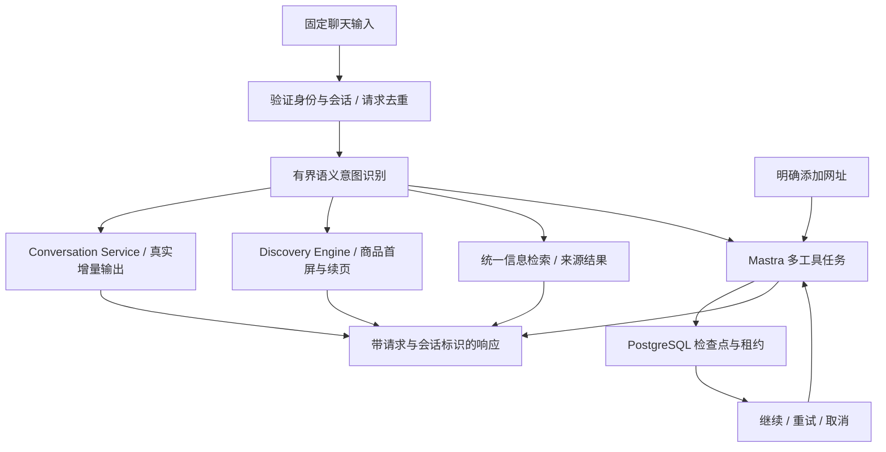

# Architecture V2.1 阶段 4、5 执行记录

日期：2026-11-13。接续阶段 0–3 的本地改动，不提交、不推送、不部署应用。

## 状态

阶段 4 的独立对话服务、流式输出、请求幂等、多工具 Mastra 流程及持久任务已实现。阶段 5 已接入用户提供的网址，建立商品、服务、已发布内容和私有网页资料的统一检索索引。

开发库 `omnilink-dev`（`fpypixbxsfpzrihwgmfk`）已应用 `20261113010000_consumer_execution_information.sql`。工具生成的版本 `20261112162334` 通过官方 CLI 的 migration repair 对齐为仓库版本；仅调整迁移登记，没有重跑历史迁移。

真实模型验收仍未完成：阶段 2、3 已确认当前千问密钥返回 `401 invalid_api_key`，本轮未替换密钥。浏览器使用独立生产服务及本地模型测试响应；数据库、任务接口和公开网页读取是真实调用。测试成功不代表真实模型的延迟、费用或回答质量已通过验收。

## 输入与执行分流

普通文本仍先分类。明确的附件和任务按钮通过服务端固定动作进入相应流程，不让模型选择任意工具或构造数据库权限。

## 阶段 4：对话、幂等与任务恢复

### 独立 Conversation Service

- `lib/consumer-advisor/conversation-service.ts` 负责普通问答和商品问答。无需个人信息时不读取记忆；未选商品时不读取目录；无需网页资料时不读取来源。
- 输入只包含最近 4 条简短历史、最多 6 条已确认记忆、最多 6 件公开商品，以及最多 2 份各 1800 字符的网页摘要。当前问题优先于长期偏好，不向模型发送全量目录和完整问卷。
- 支持千问、DeepSeek 和 Gemini 的供应商真实流式传输。按 UTF-8 增量解析，检查序号、请求和会话；必须收到最终响应才算完成。JSON 兼容响应也校验新版本的请求与会话标识。
- 停止会中断上游请求并保留已显示文字。断流显示失败，不能把半段回答伪装成完整结果。切换会话后的迟到数据不能写进新会话。
- 只有明确的自述偏好可以生成待确认提案；网页文字与模型输出不能直接激活长期记忆。

### 请求幂等

- `consumer_requests` 按验证后的用户或访客、会话和 requestId 保留请求指纹。相同标识但不同内容返回冲突；运行中的请求返回 409，不猜测上游是否已计费并重新调用。
- 完成结果及登录用户的助手历史在同一事务写入。客户端消息标识使用 UUID，避免多个窗口在同一毫秒产生相同标识。
- 完成的请求可重放且不调用模型。商品发现重放会重新读取拥有的搜索引用并核对公开状态；信息检索重放会重新执行带归属过滤的查询。
- 去重窗口为 24 小时，不承诺永久幂等。记录过期后需要新请求；异常中断且无法确认上游结果时，不自动重复生成。
- 新访客先通过 428 建立 HTTP-only cookie，再使用完全相同的请求体继续。服务端密钥不进入浏览器。

### 首条 Mastra 多工具流程

实现位于 `lib/consumer-advisor/comparison-workflow.ts`，接口为 `/api/consumer/tasks`。

1. `read-confirmed-context`：读取已确认上下文版本。
2. `read-published-products`：读取用户所选的公开商品，最多 6 件。
3. `read-user-provided-sources`：读取用户明确提供的 HTTPS 网页，最多 2 个，并发处理独立网址。
4. `compare-verified-facts`：并发复核上下文、商品公开状态和来源版本，组装带原始链接的对比表。缺失字段保持未知，不编造价格、库存或规格。

使用已安装 `@mastra/core` 的 `createTool`、`createStep`、`createWorkflow` 执行真实步骤。每次 continuation 最多执行一个新工具，然后保存检查点并暂停。后续请求跳过已完成步骤；工具执行不需要模型润色。

**恢复由应用自己的 PostgreSQL 检查点实现。** 每次 continuation 建立新的 Mastra run，禁用 SDK 快照持久化；本轮没有实现 Mastra 原生 snapshot/suspend/resume 存储适配器。浏览器验证在保存第一个步骤后重启了独立 Next 服务器，使用原任务和访客归属继续完成，证明恢复不依赖进程内对象。

- 任务支持 pending、running、paused、completed、failed、cancelled。
- 45 秒租约、递增 revision 和租约令牌共同约束写入；取消会作废租约。迟到的检查点或来源写入不能复活已取消任务。
- 正常继续不增加重试次数；显式重试和失效租约接管合计最多 3 次。偏好版本冲突会要求重新确认，并清理相关旧步骤。
- 已完成任务重新打开时，也会重新读取公开商品及当前仍有权读取的来源，不直接返回过期商品快照。
- 登录用户的任务引用写入聊天历史；访客本地历史可恢复任务引用，但读取仍需有效 cookie。任务保留 24 小时；现有访客 cookie 有效期为 1 小时，过期后不承诺恢复旧访客数据。
- 没有常驻后台执行器。关闭页面会停止后续推进，重新打开或发起继续请求后恢复执行；若业务要求用户离线也必须完成，应引入持久队列与 Worker。

## 阶段 5：外部资料与跨实体索引

### 网页接入

- 固定输入的加号菜单增加“网址”，不新增第二个聊天入口。
- 仅允许公开 HTTPS、443 端口，无用户名和密码；拦截环回、私网、链路本地、保留地址及混合公私 DNS 结果。
- 连接锁定到已验证的 IP，保留原域名的 HTTP Host、TLS SNI 和证书校验。每次重定向重新验证，最多 3 次。
- 使用 Node 全局连接代理，兼容本机既有代理配置；独立 CONNECT 探针确认代理目标仍为锁定后的公开 IP，未退回域名解析。
- 单网页 10 秒预算、512 KB 上限，仅支持 HTML 和纯文本。移除脚本等内容后保留最多 6000 字符正文；不支持登录网页、浏览器自动化、付费墙或任意文件下载。
- 网页保存原始网址、标题、正文摘要、抓取时间、内容指纹和版本。它是待核验的资料来源，不自动转化成已核验商品事实。
- 私有网页按用户或访客及会话隔离。登录来源有效期 30 天，访客来源 1 天。新请求分批清理过期来源及任务；即使尚未物理清理，读取仍排除过期项。

### 统一信息检索

- `consumer_information_documents` 是物化维护的派生索引，覆盖 product、service、content、source。公开投影排除草稿及待发布修改，私有网页保留 owner 与 session。
- 商品、渠道、价格、媒体、店铺、内容及来源变化通过数据库触发器同步索引。索引使用 `simple` 全文向量及 GIN；中文补充按查询词的 AND 子串匹配。
- 返回前再关联公开投影或私有来源，核对发布状态、归属和有效期。旧索引不能重新公开下架或无权读取的信息。
- `/api/consumer/information` 和语义 information-search 共用检索入口，最多返回 20 条。后续问答仅按归属读取必要的来源摘要，并要求在相关结论旁附上原始网址。
- 当前是有界关键词检索与来源引用，不是已完成质量评估的跨语言语义 RAG。没有在请求中同步重建全库向量。

## Token 与速度边界

| 路径 | 模型调用 | 控制方式 |
| --- | --- | --- |
| 普通文本问答 | 分类 1 次，回答 1 次 | 分类最多 512 输出 tokens、8 秒；回答最多 1024 输出 tokens、30 秒，各尝试 1 次 |
| 商品或信息发现 | 分类 1 次 | 数据库组装结果，不再调用模型润色 |
| 翻页、恢复、重放 | 0 次 | 使用拥有的引用、游标及持久结果 |
| 明确添加网址及继续任务 | 0 次 | 固定 Mastra 工具读取及确定性结果组装 |
| 文本发起对比 | 分类 1 次 | 后续固定工具、重试和结果核验不调用模型 |

DeepSeek V4 Pro 的意图分类继续使用已连接账号的 Flash；不使用平台 DeepSeek 密钥兜底。新流式普通回答关闭 DeepSeek thinking。

响应中的 `usage` 仅记录供应商返回的回答阶段 tokens，标记 `usageScope=conversation`；缺失时为 null。它不包含分类阶段的 tokens，不能作为整轮账单。旧图片、文件和穿搭分支没有完整计数时，modelCalls 保持 null，并只给出已知下界。

## Redis、Worker、Commerce Agent 的决定

| 组件 | 当前决定 | 再次评估的实际触发条件 |
| --- | --- | --- |
| Redis | 暂不引入 | 有非空目录和真实请求后，查询计划、重复率及 p95 延迟证明数据库读取成为主要瓶颈；缓存必须继续带权限、发布与上下文版本边界 |
| 独立 Worker / 持久队列 | 暂不引入 | 需要离线完成、定时刷新来源、批量向量化，或步骤持续超出请求预算；届时沿用任务标识、租约及幂等协议 |
| Commerce Agent | 暂不引入 | 明确进入购物车写入、订单或支付；另行定义授权、确认、重放及补偿，不能沿用当前只读工具的权限 |

当前开发库公开商品与内容均为 0，不能据此声称完成目录规模测试或生产 p95。一次真实数据库、公开网页和剩余任务步骤的执行约 12.39 秒，包含网络与多次请求往返；只证明当前短流程可执行，不足以证明大规模系统无需 Worker 或缓存。

## 验证与证据

- `npm test -- --reporter=dot`：41 个文件，245 项通过。
- Next 生产构建内置 TypeScript 检查通过，51 个静态页面生成成功。外置盘曾出现 Turbopack 持久缓存 fsync I/O 错误，缓存已隔离，重新构建结果见下方复核记录。
- 本次修改文件 ESLint 无错误；全仓 lint 仍有 12 个既有错误，位于 OrbitImages 和 login-package，未声称全仓 lint 通过。
- PGlite 执行实际迁移，验证 RLS、服务端专用 RPC、幂等事务、租约接管、取消后写入阻断、重试上限、发布索引维护、草稿隔离和私有来源隔离。
- `scripts/verify-stage45-browser.mjs`：9 项通过。覆盖真实增量显示、重放零新增模型调用、停止后返回已取消、加号网址任务、服务器重启恢复、跨访客和跨会话拒绝、取消、来源跟进问答，以及桌面和 390px 布局。
- `scripts/verify-stage23-browser.mjs`：8 项回归通过，覆盖瀑布流首屏、续页及失败保留、换会话、记忆编辑、评测暂停恢复和确认流程。
- 新浏览器测试未拦截业务 API：仅模型供应商由本地 fixture 代替。真实访问开发数据库和公开的 example.com，未创建公开测试商品或登录用户。
- 供应商 fixture 的一次首段可见约 934ms，完整结果约 4195ms；输出 tokens 是 fixture 数据，不能作为真实模型性能或费用基准。
- 测试产生的 9 个访客任务、4 份网页来源和 18 条请求记录已按本轮精确会话清理；原有 2 条聊天记录及商品、内容数据保留。

本机临时证据位于 `/private/tmp/omnilink-stage45-browser/`、`/private/tmp/omnilink-stage23-browser/`，包含截图、结果 JSON 和服务日志。重新运行脚本会重新建立隔离浏览器及测试数据。

### 界面审视

沿用现有冷白、图片优先的市场与紧凑对话布局。ENERGY 1 / RHYTHM 2 / MOTION 1。

| Antislop 检查 | 结果与依据 |
| --- | --- |
| Hard Gate | 通过。没有新增模板页面、装饰数据或虚构商品；错误与未知资料明确显示 |
| Purpose Gate | 通过。表格用于比较可核验字段，列表用于来源；不新增玻璃卡片、阴影或装饰动效 |
| Liveliness | 通过。固定输入保持焦点，沿用品牌与蓝色焦点状态；正文、来源、步骤通过间距和字重区分 |
| Craftsmanship | 通过。桌面和 390px 截图复核；表格标签不拆字，移动端滚动区避开导航，细线、文字尺度和 hover 沿用语义变量 |

## 参考

- [Mastra 工作流步骤与工具](https://mastra.ai/docs/workflows/agents-and-tools)
- [Mastra suspend 与 resume](https://mastra.ai/docs/workflows/suspend-and-resume)
- [Mastra 工作流快照](https://mastra.ai/docs/workflows/snapshots)
- [Node HTTPS](https://nodejs.org/api/https.html) 与 [代理支持](https://nodejs.org/download/release/latest-v24.x/docs/api/http.html#built-in-proxy-support)
- Next.js 16.4.5 的本地 Route Handlers 与 Turbopack FileSystem Caching 文档

## 构建与数据复核

隔离旧的生成缓存后，`npm run build` 再次退出 0：编译 5.2 秒，TypeScript 3.1 秒，静态页面 51/51。没有再出现 fsync 或 I/O 错误。仍有既有 middleware 弃用及本地 BGE 动态文件追踪警告，未修改应用配置掩盖警告。

开发库清理后复核：公开商品 0、内容 0、原有聊天记录 2；请求、执行任务、外部来源及派生索引均为 0。最新迁移登记为 `20261113010000`。四张新增表均启用 RLS；anon、authenticated 均不能直读写索引或执行任务 RPC，service_role 可以。全程未提交或推送 Git 改动，未部署应用。
