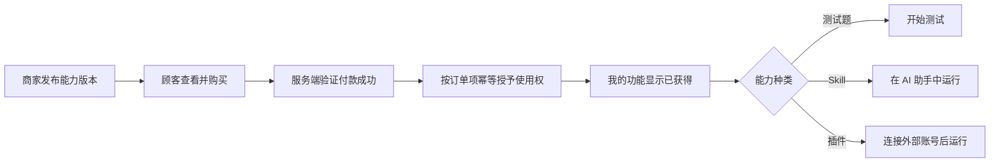

# AI 助手 Agent 与可购买能力：设计方案

状态：分阶段实施中。C 端已有能力库空状态与示例说明，以及数字能力商品详情的前端预留；AI 助手的「目标任务入口」已按界面要求移除。商家快速新建与完整商品编辑器均可保存数字能力草稿，发布仍被禁用。真实能力上架、支付、使用权和 Agent 任务执行尚未实施。数据库核对与落地顺序见 [新增模块数据库设计核对](new-modules-database-review.md)。范围是 C 端 AI 助手、灵感市场、商家商品管理、结账和「我的功能」。

## 目标与边界

**产品目标：现有「AI 助手」演进为顾客的个人 Agent。**顾客交代目标后，它能澄清约束、拟定步骤、调用已授权能力、检查结果并汇报；经顾客明确开启的任务可以稍后继续。购买的测试题、Skill 和插件是这个 Agent 的能力组件，不是三个独立的 Agent。

顾客购买能力后，系统在确认付款的同一账号下自动授予使用权，并在「我的功能」中显示。用户可以立即打开测试题和无需额外授权的 Skill；需要连接外部账号的插件先显示为「待连接」，连接完成后才可运行。

本次新增的是**交付属性**，不是把「虚拟商品」当作一个服饰或家居分类。普通实体商品继续使用现有商品目录与购物流程。系统必须区分三件事：商品是否已付款、用户是否拥有使用权、能力当前是否可运行。

## 现状与复用点

- `catalog_items.item_type` 已有 `product | service | skill`，`catalog_variants.availability_type` 已有 `unlimited`。作为商品售卖的数字能力统一使用 `item_type=product`；其具体类型只由 `capability_kind` 表示，不再对 Skill 重复写 `item_type=skill`。旧枚举值保留给原有目录用途。
- 「我的功能」现在是前端固定的三个功能、两个 Skills 和「暂无已连接插件」，还没有顾客的已购能力数据源。
- 商家工作台已有 `workspace_skills`、版本和安装状态。这些表服务商家组织与店铺，不适合直接承载顾客购买后的个人使用权。
- 当前 `/store/[store_slug]/checkout` 调用 `submitOrderInquiryAction`，创建的是 `inquiry_pending` 询盘；没有已验证的收款事件。**询盘成功不得自动开通付费能力。**
- C 端 `/api/consumer/assistant` 目前使用固定系统提示词和商品目录，单次请求生成答复；没有任务状态、分步执行、按用户已购能力选择执行器或稍后继续的流程。因此当前实现是聊天助手，目标中的 Agent 尚需建设。

## Agent 本体：接目标并推进任务

Agent 是「AI 助手」背后的运行方式。一次任务至少包含：用户目标与约束、当前计划、每一步的输入与结果、可调用的能力清单、执行状态，以及何时需要用户决定。它可以用多个 Skill 和插件完成一个目标，也可以在没有购买能力时使用平台内置能力。

例如用户说「下周参加户外婚礼，预算 1000 元；先用我的衣橱，缺的再推荐」。Agent 先确认场合和尺码，再读取用户已授权的衣橱数据，调用搭配 Skill，查询商品与库存，检查总价后给出两套方案。商品缺货时，它可以重新选择。加入购物车须由用户确认；付款仍由用户完成。只有用户明确开启「持续跟进」，才创建后续的库存/价格检查任务。

运行层建议由四个部件组成：

| 部件 | 职责 |
| --- | --- |
| 任务管理 | 保存目标、约束、计划、步骤、状态和可恢复的执行记录。 |
| 能力解析 | 合并平台内置能力与该用户的有效使用权，过滤未连接或已撤销的能力。 |
| 执行器 | 在服务端调用受控的测试、Skill、商品查询及插件适配器；每一步有明确输入输出。 |
| 检查与交接 | 核对结果和预算、识别失败与缺失信息；需要用户授权或决策时暂停并解释原因。 |

后续跟进任务必须有明确的触发条件、结束时间和用户可见的关闭入口。建议新增 `consumer_agent_tasks` 与 `consumer_agent_task_steps` 保存任务及步骤；聊天记录只负责展示对话，不承担任务状态的唯一存储。任务执行前以及恢复时都重新核对用户身份、能力使用权和插件连接状态。

## 商品模型

在商品管理界面增加「交付方式」字段：

| 字段 | 建议值 | 用途 |
| --- | --- | --- |
| `delivery_type` | `physical`、`ai_capability` | 决定结账资料、库存/物流及付款后的交付流程；现有商品默认为 `physical`。 |
| `capability_kind` | `question_set`、`skill`、`plugin` | 仅 `ai_capability` 必填，决定详情页和「我的功能」中的使用入口。 |
| `capability_version_id` | 指向已发布的不可变版本 | 订单记录购买时的版本，避免商家修改商品后改变已售内容。 |

`catalog_items` 仍保存公开商品信息，`catalog_variants` 仍保存价格和 SKU。新增 `ai_capability_versions` 保存结构化交付清单，包含 `kind`、版本号、标题、摘要、封面、发布状态、输入输出约定和运行器类型。可按版本存储实际内容：

- **测试题**：题目、选项、答案/评分规则、结果说明及预计用时。购买后显示「开始测试」，完成记录只对本人可见。
- **Skill**：用途、可用范围、输入参数、输出样式、提示词/工作流版本。购买后显示「在 AI 助手中使用」。
- **插件**：平台维护的适配器 ID、权限范围、连接说明及可用状态。购买后先进入个人库；若需要第三方账号，显示「连接后使用」。不允许商家上传任意服务端代码作为可执行插件。

商家上架表单按种类显示对应字段，并在发布前验证内容完整性。商品详情明确展示「数字交付」「包含内容」「使用入口」「是否需要连接」「版本/更新规则」。数字商品购物车数量默认限制为 1；实体商品和数字商品混购时，结账界面只对实体商品收集物流信息。

## 购买、交付与使用流程

1. 购买前要求顾客登录，使订单和使用权绑定到稳定的 `auth.users.id`；首版不做访客邮箱自动认领。
2. 收款服务的服务端通知经过签名验证并确认金额、币种、订单与支付状态后，订单进入 `paid`。浏览器的成功跳转只能展示结果，不能授予使用权。
3. 交付服务逐条读取订单项快照，按 `(order_item_id, buyer_user_id)` 幂等创建使用权。重复通知、重试或刷新不会多次开通。
4. 「我的功能」从服务端读取当前用户的使用权。刚付款时显示「正在加入」；成功后显示「已加入」。异常时显示「开通中，可在订单中查看进度」，由服务端重试。
5. 退款、拒付或管理员撤销使使用权进入 `revoked`，历史订单与测试结果保留；界面说明不可再运行。

建议新增独立的 `consumer_capability_entitlements`，核心字段为 `buyer_user_id`、`order_item_id`、`catalog_item_id`、`capability_version_id`、`status`（`active | revoked`）、`granted_at`、`revoked_at`。「待连接」由独立的 `consumer_capability_connections` 状态推导，不改变已购使用权。连接表仅记录用户与平台适配器的连接状态和权限范围，不在浏览器或普通表列保存第三方密钥。测试记录另表存储。付费内容文件放私有存储，读取前检查使用权。

## 「AI 我的」界面

沿用现有「AI助手 / 我的功能」切换，不新增底部导航项。「AI助手」负责接收目标、显示步骤与结果，并提供「进行中任务」及停止跟进入口。「我的功能」负责管理可用能力，分为平台内置功能与**已获得的能力**。后一段提供「全部 / 测试题 / Skills / 插件」筛选，每张卡片显示名称、来源店铺、状态和一个明确主操作。

| 状态 | 卡片文案与主操作 |
| --- | --- |
| 未购买 | 商品页显示「购买后加入我的功能」；个人页不伪装为已拥有。 |
| 付款处理中 | 「正在确认付款」；操作不可用，提供查看订单入口。 |
| 已获得测试题 | 「开始测试」；重复进入可继续上次进度。 |
| 已获得 Skill | 「在 AI 助手中使用」；打开助手并选中该 Skill。 |
| 插件待连接 | 「连接后使用」；说明将申请的权限，再进入连接流程。 |
| 已撤销 | 「使用权已结束」；提供订单/售后入口。 |

付款成功页直接给出「已加入我的功能」和「立即使用」入口；若开通任务尚未完成，则明确显示处理中。移动端卡片同排控件保持相同高度、垂直居中，操作可键盘聚焦；状态变化以完整文案向辅助技术播报，而不是只更新一个数字。

## AI 执行边界

Agent 选择能力后，由服务端根据当前登录用户的有效使用权加载版本清单，再路由到允许的执行器。客户端传来的 `capability_id` 只用于选择，不能作为授权凭据。测试题由题库执行器评分；Skill 通过受控提示词/工作流运行；插件只调用平台注册、审核过的适配器，并按用户已同意的权限范围访问外部服务。商品介绍、题目、Skill 提示词和插件返回内容都作为不可信输入处理，不能覆盖系统规则或扩大工具权限。记录必要的运行审计与失败原因，不把密钥或私有内容写入聊天记录。

Agent 可以自主完成读取、分析、比较和起草步骤；购买、付款、向外部发送内容、扩大插件权限等动作必须停在相应的用户确认点。这样「持续执行」表示在授权边界内继续推进任务，不表示无限期自行操作。

## 落地顺序与验收

1. **Agent 基础**：让 AI 助手保存任务和步骤，能分步使用平台内置能力、检查结果、暂停求助、恢复任务；持续跟进须由用户单独开启。
2. **目录与展示**：新增交付方式、能力种类和版本清单；完成商家上架校验、商品详情及购物车提示。旧商品默认实体交付。
3. **支付与使用权**：引入真实支付成功状态、登录购买、订单项版本快照、幂等发放和退款撤销。若支付能力尚未上线，只能在明确标记的本地测试流程中模拟 `paid`，公开页面不得宣称已自动开通。
4. **个人库与能力接入**：个人库读取真实使用权，让 Agent 先调用测试题和受控 Skill，再接入需要外部授权的插件。

验收场景：Agent 能将一个目标拆成可见步骤，跨请求恢复且不会重复执行已完成步骤；用户未开启跟进时不会产生后台任务；需要用户决定时会暂停。同一订单重复支付通知只生成一次使用权；未付款、另一用户和已退款用户不能运行；购买后的账号在另一设备登录仍能看到能力；版本更新不改变订单快照；插件未连接时不会发起外部调用；数字商品不要求填写收货地址；实体商品结账保持原有行为。

## 本设计的产品决策

- 首版按**账号永久使用权**设计；订阅、次数包、转赠和家庭共享后续扩展。
- 商家可以发布题库与受控 Skill；可执行插件只由平台提供经过审核的适配器，商家选择并配置可售权益。
- 已购版本保持可用；是否给老顾客免费升级到新版本由未来单独的升级策略决定。
- 第一版数字商品要求登录购买；访客购买后的邮箱认领流程暂不纳入范围。

## 参考

- Supabase [RLS 文档](https://supabase.com/docs/guides/database/postgres/row-level-security)：新表需要同时明确数据库权限和逐用户访问策略。
- Supabase [私有存储文档](https://supabase.com/docs/guides/storage/buckets/fundamentals)：付费内容应使用私有存储与受控访问。
- Supabase [Data API 暴露方式变更](https://supabase.com/changelog/45329-breaking-change-tables-not-exposed-to-data-and-graphql-api-automatically)：新增表不能假设会自动对客户端开放。
