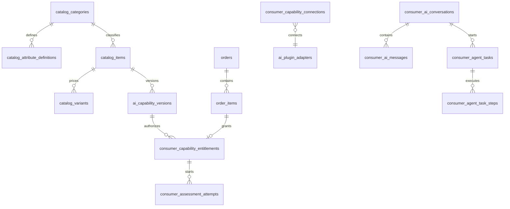

# 消费者 AI 能力与商品数据库设计

状态：设计稿，2026-10-18。面向现有 Supabase/Postgres 17 结构；未创建迁移，未修改远程数据库。现状核对见 [新增模块数据库设计核对](new-modules-database-review.md)。

## 设计决定

1. 商品身份仍是 `catalog_items`，售卖价格仍是 `catalog_variants`。所有作为商品售卖的数字能力使用 `item_type=product`；数字能力是交付方式，测试题、Skill、插件只由 `capability_kind` 区分。不借用服装或家居分类，也不复用商家工作台的 `workspace_skills` 作为顾客使用权。
2. 订单付款、能力使用权、插件连接分别存储。`inquiry_pending` 不等于 `paid`；一个已购插件可以处于待连接状态，同时继续保有使用权。
3. 购买时固定不可变能力版本。商家后来发布新版，不静默改变旧订单的交付内容。
4. 商品说明可以公开；题目答案、完整 Skill 工作流、插件令牌和顾客任务记录不能出现在公开商品投影中。
5. 先完成分类与数字能力草稿的数据规范化，再接支付交付，最后让 Agent 使用已授权的能力。

## 数据关系

## 表与字段

### A. 已有目录表的调整

| 表 | 变更 | 约束与用途 |
| --- | --- | --- |
| `catalog_categories` | 沿用 `(organization_id, code)` 唯一键；使用前端稳定分类编码作为 `code`。 | 每个组织有自己的分类 UUID。迁移脚本按编码幂等建立分类和父子关系；不把 `cat-*` 字符串直接写入 UUID 外键。 |
| `catalog_attribute_definitions` | 沿用分类字段定义；以 `(organization_id, category_id, code)` 唯一键同步预设。 | 仅同步系统管理的字段；商家修改过的字段不被新版静默覆盖。`options` 保持 JSON 数组。 |
| `catalog_items` | 新增 `delivery_type text not null default 'physical'`、`capability_kind text null`、`current_capability_version_id uuid null`。 | `delivery_type in ('physical','ai_capability')`；仅数字能力可有 `capability_kind in ('question_set','skill','plugin')`，且售卖的数字能力 `item_type=product`。当前版本指针只能指向同一商品的已发布版本。旧 `details` 可保留展示字段，但不再作交付判定依据。 |
| `catalog_variants` | 数字能力 SKU 使用 `availability_type='unlimited'`，`availability_value` 为 `null`。 | 价格仍用现有 `numeric(14,2)` 与币种列；数字能力默认数量 1。 |
| `catalog_item_attributes` | 存实际商品属性值。 | 快速新建与完整编辑统一写入此表；`specification_schema` 仅可作为历史兼容或界面草稿，不是唯一事实源。 |

`catalog_items.current_capability_version_id` 的复合外键建议指向 `ai_capability_versions(id, catalog_item_id)`，因此版本表还需为这组列设唯一键。发布流程先插入版本，再在同一事务中更新商品指针；触发器或受控发布函数要核对该版本已发布且类型一致。商家编辑商品文本不改变已发布版本内容。

### B. 能力交付定义

| 新表 | 关键列 | 约束、索引与访问 |
| --- | --- | --- |
| `ai_capability_versions` | `id uuid`、`organization_id uuid`、`catalog_item_id uuid`、`kind text`、`version_number integer`、`status text`、`manifest jsonb`、`published_at timestamptz`、`created_at timestamptz`。 | `(catalog_item_id, version_number)` 和 `(id, catalog_item_id)` 唯一；`version_number > 0`；同组织复合外键；`manifest` 为对象；发布后内容不可变。索引 `(catalog_item_id, status, version_number desc)`。公开页面只读商品说明，不直接读取 `manifest`。 |
| `ai_plugin_adapters` | `id text`、`name text`、`status text`、`allowed_scopes jsonb`、`created_at timestamptz`。 | 平台维护的适配器注册表；商家版本清单只能引用已批准适配器。放非暴露 schema，或在 `public` 中撤销客户端权限并启用 RLS。不可将任意商家代码当作可执行插件。 |

`kind` 限于 `question_set/skill/plugin`，版本 `status` 限于 `draft/published/retired`。`manifest` 按 `kind` 在服务端采用版本化 schema 校验：题库含题目和评分规则，Skill 含输入/输出契约及受控工作流，插件含适配器 ID、所需 scope 与连接说明。商品公开信息不复制完整 `manifest`。首版版本使用整数递增，订单永远引用版本 ID；将来升级使用权需要显式升级记录。

### C. 支付与使用权

| 表 | 关键列 | 约束、索引与访问 |
| --- | --- | --- |
| `orders`（已有） | 新增 `buyer_user_id uuid null`、`paid_at timestamptz null`；支付状态迁移应收敛允许值。 | 数字能力结账要求 `buyer_user_id`；已有访客询盘可继续为空。仅经已验证的服务端支付事件设置付款事实。索引 `(buyer_user_id, created_at desc)`。 |
| `order_items`（已有） | 新增 `delivery_type_snapshot text`、`capability_version_id uuid null`。 | 数字能力行要求版本 ID、`product_id` 与 `quantity=1`；通过 `(capability_version_id, product_id)` 复合外键防止版本与商品错配。保留名称、单价、币种等已有快照。 |
| `private.payment_events` | `id uuid`、`provider text`、`provider_event_id text`、`order_id uuid`、`event_type text`、`verified_at timestamptz`、`payload_hash text`、`processed_at timestamptz`。 | `(provider, provider_event_id)` 唯一，用于 webhook 幂等；原始敏感载荷不进入顾客可读表。支付服务调用与数据库事务分离，事务只更新已验证结果。 |
| `consumer_capability_entitlements` | `id uuid`、`buyer_user_id uuid`、`order_item_id uuid`、`catalog_item_id uuid`、`capability_version_id uuid`、`status text`、`granted_at timestamptz`、`revoked_at timestamptz`、`revoke_reason text`。 | `order_item_id` 唯一保证重试只发一次；`status in ('active','revoked')`。`pending_connection` 不放在此表；它由连接表推导。索引 `(buyer_user_id, status, granted_at desc)`。买家只读自己的行，写入由受控交付服务完成。 |

支付通知处理顺序：先在应用层验证签名、金额、币种与订单；再在短事务中去重事件、将订单置为 `paid`、逐条创建使用权。重复通知返回同一结果；退款/拒付记录事件并撤销使用权。不能从浏览器成功页、询盘提交或客户端传来的 `paid` 字段发放权益。

### D. 个人能力状态

| 新表 | 关键列 | 约束、索引与访问 |
| --- | --- | --- |
| `consumer_assessment_attempts` | `id uuid`、`buyer_user_id uuid`、`entitlement_id uuid`、`status text`、`answers jsonb`、`result jsonb`、`started_at timestamptz`、`submitted_at timestamptz`。 | 使用权必须属于同一用户且指向题库版本；状态限于 `in_progress/submitted/scored/abandoned`；`answers`、`result` 为对象。索引 `(buyer_user_id, entitlement_id, started_at desc)`。客户端只读自己的结果，提交/评分由服务端校验。答案密钥不写入本表。 |
| `consumer_capability_connections` | `id uuid`、`buyer_user_id uuid`、`adapter_id text`、`status text`、`approved_scopes jsonb`、`connected_at timestamptz`、`revoked_at timestamptz`。 | `(buyer_user_id, adapter_id)` 唯一；状态限于 `disconnected/pending/connected/revoked`；`approved_scopes` 为数组。索引 `(buyer_user_id, status)`。顾客只读自己的连接状态及 scope。 |
| `private.consumer_plugin_credentials` | `connection_id uuid`、`secret_ref text`、`updated_at timestamptz`。 | 仅服务端可访问；`connection_id` 唯一且引用连接表。第三方令牌存受控密钥存储，本表只保留引用。 |

「我的功能」从 `consumer_capability_entitlements` 读取实际拥有的能力：题库可开始或继续，Skill 可交给助手，插件在未连接时显示「待连接」。每次运行仍按当前用户和有效使用权重新授权。不同用户不能借用同一个版本 ID 越权执行。

### E. AI 对话与 Agent 任务

| 新表 | 关键列 | 约束、索引与访问 |
| --- | --- | --- |
| `consumer_ai_conversations` | `id uuid`、`user_id uuid`、`title text`、`created_at timestamptz`、`updated_at timestamptz`。 | `(id, user_id)` 唯一，供消息和任务复合外键引用；索引 `(user_id, updated_at desc)`；仅本人可读。 |
| `consumer_ai_messages` | `id uuid`、`conversation_id uuid`、`user_id uuid`、`role text`、`content jsonb`、`created_at timestamptz`。 | `(conversation_id, user_id)` 复合外键防止消息挂到他人会话；`role` 限于 `user/assistant/tool`，`content` 为对象；索引 `(conversation_id, created_at)`。媒体用私有对象路径，不在消息里持久化 base64。 |
| `consumer_agent_tasks` | `id uuid`、`conversation_id uuid`、`user_id uuid`、`goal text`、`constraints jsonb`、`status text`、`follow_up_enabled boolean`、`follow_up_policy jsonb`、`expires_at timestamptz`、`created_at timestamptz`、`updated_at timestamptz`。 | `(conversation_id, user_id)` 复合外键；状态限于 `queued/running/waiting_for_user/completed/failed/cancelled`；索引 `(user_id, status, updated_at desc)`。持续跟进默认关闭；开启时要求非空结束时间和经验证的触发条件。 |
| `consumer_agent_task_steps` | `id uuid`、`task_id uuid`、`step_no integer`、`executor_key text`、`capability_version_id uuid null`、`status text`、`input_snapshot jsonb`、`output_snapshot jsonb`、`error_code text`、`started_at timestamptz`、`completed_at timestamptz`。 | `(task_id, step_no)` 唯一，`step_no > 0`；状态限于 `pending/running/waiting_for_user/completed/failed/skipped`；索引 `(task_id, status, step_no)`。步骤输入/输出存必要摘要，不存密钥或完整付费内容；重试时不得重复已完成的外部动作。 |

Agent 每次执行或恢复前检查用户身份、能力使用权、插件连接及任务状态。对外发送、购买、付款和扩大授权必须停在用户确认点。客户端历史消息不能充当唯一任务状态。

## RLS、授权与完整性

- 所有位于 `public` 的新表在创建时启用 RLS；按实际 API 用途显式 `GRANT`。Supabase 已宣布新建表不会继续默认暴露给 Data API；`GRANT` 与 RLS 是两层独立控制。[变更说明](https://supabase.com/changelog/45329-breaking-change-tables-not-exposed-to-data-and-graphql-api-automatically)
- 顾客表的 `SELECT` 策略使用 `user_id = (select auth.uid())` 或 `buyer_user_id = (select auth.uid())`。客户端不拥有使用权、付款事件和版本清单的写权限；服务端写入也必须验证身份与订单事实。
- 子表外键尽量同时带上用户或组织 ID，防止跨租户组合；Postgres 不会自动给外键建索引，按实际查询与删除路径补索引。`UPDATE` 策略若开放，必须同时限定旧行和新行，且提供对应 `SELECT` 策略。[RLS 指南](https://supabase.com/docs/guides/database/postgres/row-level-security)
- `catalog_item_id`、版本和订单项在发放时核对同一商品；商家组织归属沿用现有复合外键。已售版本和权益历史使用 `RESTRICT` 或软归档，不能被商家删除商品时级联清空。
- `jsonb` 只承载不同能力的可变契约和运行摘要；身份、状态、关联、金额、时间及幂等键全部使用有约束的列。

| 数据 | 匿名访客 | 已登录顾客 | 商家组织成员 | 受控服务端 |
| --- | --- | --- | --- | --- |
| 商品公开说明 | 已发布商品可读 | 已发布商品可读 | 本组织可编辑 | 发布校验与投影生成 |
| 能力版本 `manifest` | 无权访问 | 无直接访问 | 本组织按角色编辑草稿 | 授权后读取指定版本 |
| 使用权、测试、连接、任务 | 无权访问 | 仅本人读取安全字段 | 无权访问顾客私有记录 | 付款交付、评分、连接及任务执行写入 |
| 支付事件 | 无权访问 | 无直接访问 | 仅通过订单业务接口看结果 | 验签、去重、处理与审计 |

`consumer_ai_messages` 中的私有内容不应通过直接的 `SELECT *` 返回客户端；用受控 API 返回白名单字段。连接凭据引用和支付事件放在非暴露的 `private` schema。RLS 只限制行，不能自动隐藏同一行中的敏感列。

## 迁移切分与验收

| 阶段 | 迁移范围 | 必须验证 |
| --- | --- | --- |
| 1. 分类一致性 | 组织内分类和属性定义初始化；快速创建写正式外键和属性行。 | 分类编码能解析到 UUID；商品属性可重读；不覆盖商家修改的定义。 |
| 2. 能力商品 | `catalog_items` 交付列、`ai_capability_versions`、版本发布规则；将其他环境中可能存在的 `details.delivery_type='ai_capability'` 且 `item_type='skill'` 草稿归一为 `item_type='product'`。 | 快速新建与完整编辑使用同一组 `details` 字段；旧实体商品默认实体；无版本不可发布；已发布内容不可原地改写；访客只能看到安全摘要。 |
| 3. 付款与个人库 | 先处理待部署订单迁移，再增支付事件、订单快照、使用权、测试记录和连接表。 | 重复 webhook 只发一次；未付款、跨账号、退款后均不能运行；插件待连接不丢失使用权。 |
| 4. Agent | 对话、任务、步骤与恢复机制。 | 跨设备可读；中断后不重复已完成步骤；未开启跟进不产生后台任务；撤销使用权后恢复失败且原因可见。 |

每阶段都要在本地数据库执行迁移、重新生成 `lib/database.types.ts`、验证 RLS 的正反例，再考虑部署。仓库尚有暂缓的 `20261013054216_secure_public_order_inquiries`；解决该迁移前不要直接执行全量 `db push`。
