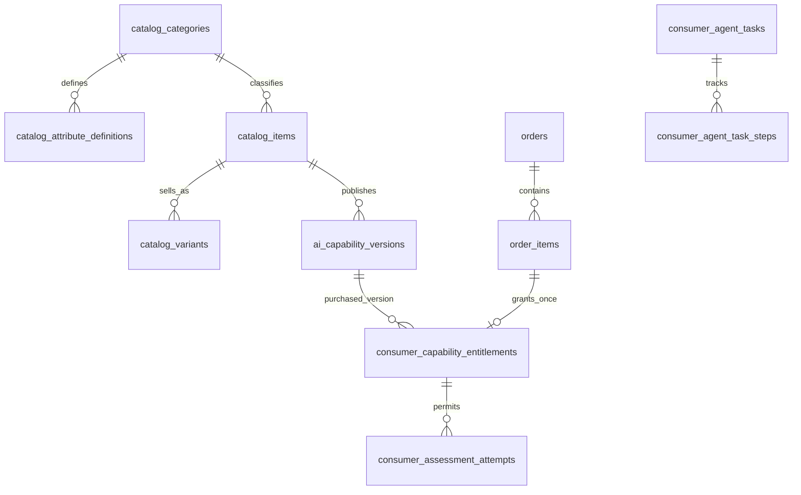

# 新增模块数据库设计核对

核对日期：2026-10-18。依据为 `supabase/migrations/`、当前 API 与前端代码，以及连接的 `omnilink-dev` 数据库只读查询。本文件是现状与缺口清单；具体表结构和约束见 [消费者 AI 能力与商品数据库设计](consumer-capability-database-design.md)。未执行数据库变更。

## 核对结论

| 模块 | 当前持久化状态 | 需要补齐的关系 |
| --- | --- | --- |
| 商品分类与属性模板 | 已有 `catalog_categories`、`catalog_attribute_definitions`、`catalog_item_attributes`；开发库这三张表均为 0 行。前端分类与模板在 `lib/product/categories.ts` 和 `lib/product/category-templates.ts`。快速新建与完整编辑现在使用相同的 `details` 字段，并通过同一 canonical-attributes 接口写商品特征；分类编码仍未解析到 `catalog_items.category_id` 的 UUID 外键。 | 建立稳定分类编码到组织内 UUID 的映射；将模板字段同步到定义表；保存商品时写正式分类外键。 |
| AI 数字能力商品 | 快速新建可保存草稿。`delivery_type`、`capability_kind` 只在 `catalog_items.details`；价格在 `catalog_variants`，数字商品使用 `unlimited`。发布被 API 禁止。 | 结构化交付类型与不可变能力版本；发布校验；购买时固定版本。 |
| 「我的功能」 | 平台功能和能力示例由前端提供；没有顾客已购能力表。`workspace_skills` 是商家工作台技能库，不能充当顾客使用权。 | 顾客使用权、测试进度、插件连接状态与授权后的能力查询。 |
| 订单与交付 | 开发库已有 `orders`、`order_items`，但都是询盘模型，当前均为 0 行。`orders` 无顾客账号外键、已验证付款事实或支付事件；`order_items` 无能力版本快照。 | 账号绑定、支付确认、订单项版本快照和幂等发放；询盘不可授予能力。 |
| AI Agent | `/api/consumer/assistant` 是单次生成接口，对话历史由客户端传入；没有任务、步骤或可恢复执行记录。 | 任务与步骤状态、用户授权范围、暂停和恢复记录。 |

开发库迁移记录截至 `20261013143618_restore_non_order_database_dependencies`。仓库中的 `20261013054216_secure_public_order_inquiries` 尚未部署，按 [数据库部署说明](database-deployment.md) 暂缓；后续迁移不能用不加区分的 `supabase db push` 推送。

## 建议的数据边界

### 1. 目录与属性模板

沿用现有 PIM 表，不另建一套“虚拟商品分类”。`delivery_type` 是交付属性，测试题、Skill、插件是 `capability_kind`，都不占用服装、家居等分类层级。

- 用 `catalog_categories.code` 保存稳定分类编码，例如前端 `cat-apparel-women`，但仍为每个组织生成自己的 UUID；`catalog_items.category_id` 必须指向该组织内分类。
- 将可编辑的属性模板同步至 `catalog_attribute_definitions`：`code`、`label`、`value_type`、`unit`、`options`、`is_required`。商品填写值落在 `catalog_item_attributes`。销售规格轴仍属于 SKU/变体逻辑，不能混成普通属性值。
- 前端预设只能作为初始化与界面提示；后续增改分类和模板应从数据库读取。同步需要版本或校验记录，避免应用发版时覆盖商家已经修改的定义。
- 快速新建当前传来的 `category_id` 是 `cat-*` 字符串，数据库外键是 UUID。服务端必须通过 `(organization_id, code)` 解析 UUID，不能直接将字符串写入外键，也不能只复制到 `details` 后视为已同步。
- 创建商品、默认变体、属性值的写入应在同一事务/RPC 中完成，避免留下只有商品行、没有完整 SKU 或属性的草稿。

### 2. 数字能力商品与版本

建议在 `catalog_items` 增加 `delivery_type`、`capability_kind` 的正式列，旧行默认为 `physical`。约束两列的组合：实体商品没有能力类型；`ai_capability` 必须是 `question_set | skill | plugin`，并统一使用 `item_type=product`。`catalog_items.details` 可保留非授权性的展示信息，不再充当交付类型的唯一来源。

新增 `ai_capability_versions`，至少包含 `id`、`organization_id`、`catalog_item_id`、`kind`、`version_number`、`status`、`manifest`、`published_at`。使用 `(catalog_item_id, version_number)` 唯一约束和同组织复合外键。已发布版本不可原地改写；订单和使用权引用其 ID。`manifest` 存经过服务端校验的题目/工作流/适配器配置，不存第三方密钥；私有内容文件放私有存储。

发布条件：能力版本已发布，种类和商品一致，销售变体合法；插件的适配器必须是平台登记并允许使用的适配器。不能因补了数据库列就移除当前的数字商品发布禁令。

### 3. 付款、使用权与个人库

在真实支付接入时，为 `orders` 增加稳定的 `buyer_user_id`，为 `order_items` 增加购买时的 `capability_version_id` 和必要的交付快照；支付服务端事件要有唯一事件 ID、签名/金额核对结果及处理状态。`inquiry_pending` 与浏览器成功跳转都不是付款证明。

新增 `consumer_capability_entitlements`：`buyer_user_id`、`order_item_id`、`catalog_item_id`、`capability_version_id`、`status`、`granted_at`、`revoked_at`。首版一个订单项授予一份能力，`order_item_id` 唯一；发放流程以已确认付款的订单项为输入，在事务中幂等插入。退款或拒付将使用权改为 `revoked`，保留历史。

`consumer_assessment_attempts` 记录测试题版本、当前进度、提交与结果，按用户和使用权隔离。`consumer_capability_connections` 记录插件适配器、用户、连接状态和授权范围；令牌放受控密钥存储，普通表只保留引用。个人库查询有效使用权，展示版本与可运行状态；真正调用能力时服务端再次核对，不能信任客户端传来的能力 ID。

### 4. Agent 任务

新增 `consumer_agent_tasks`（用户、目标、约束、状态、是否允许持续跟进、结束条件、创建/更新时间）和 `consumer_agent_task_steps`（任务、顺序、执行器/能力版本、状态、输入输出摘要、错误与时间戳）。持续跟进只能由用户显式开启；恢复任务前重新检查使用权、插件连接与授权范围。聊天消息可以单独存储，但不能代替任务状态。

## 访问控制与实施顺序

所有新增公开 schema 表启用 RLS，并显式授予实际所需的 Data API 权限。商家编辑只能触及本组织的商品与版本；顾客仅能读取自己的使用权、测试记录、连接和任务；公开商品展示只能拿到已发布版本的安全摘要，不能读取题目答案、完整 Skill 提示词或连接凭据。多租户外键使用 `(id, organization_id)` 校验归属；用户数据用 `auth.users.id`，并为 RLS 查询字段建立索引。支付发放与撤销仅由受控服务端流程写入，客户端不能直接创建使用权。

建议分四步实施，每步带迁移、类型更新和真实查询验证：

1. **分类同步**：初始化组织内分类和定义，修正快速新建与编辑的分类/属性写入；验证真实商品的 `catalog_items.category_id`、属性行与前端一致。
2. **能力商品**：增加交付列及版本表，完成发布校验、公开摘要与私有内容读取；维持草稿限制直到完整交付可用。
3. **支付交付**：先解决待部署订单迁移与支付事实，再加订单版本快照、使用权及测试/连接表；验证重复通知、退款与跨账号访问。
4. **Agent 任务**：先实现可恢复任务与步骤，再接入已购 Skill、测试题和平台插件。验证暂停、恢复、取消以及能力撤销后的拒绝执行。

在第 3 步完成前，「购买后加入我的功能」只能是产品说明，不能表现为已经自动开通。
